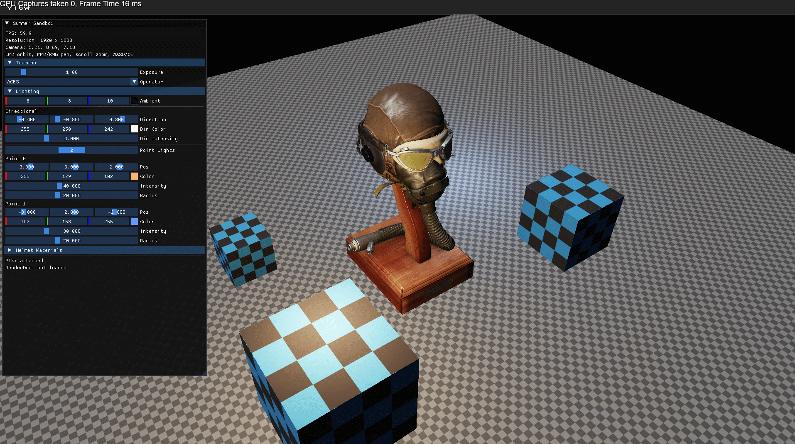
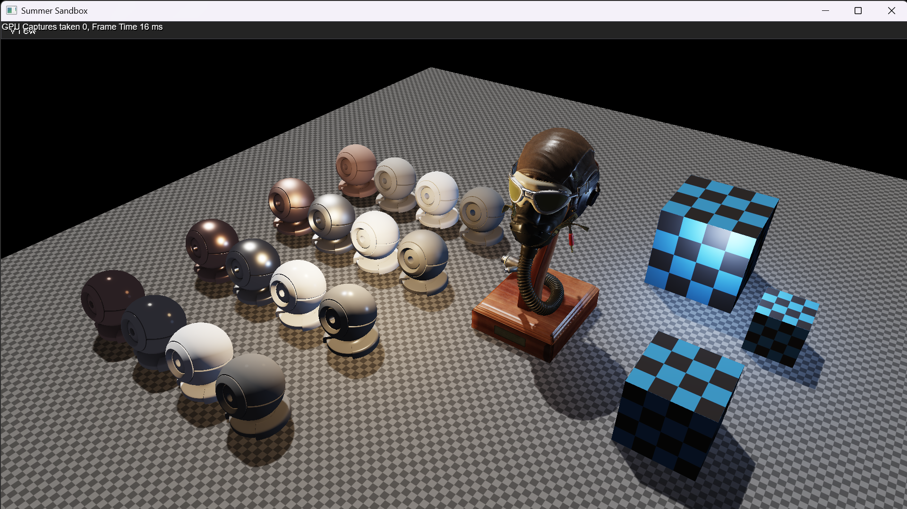
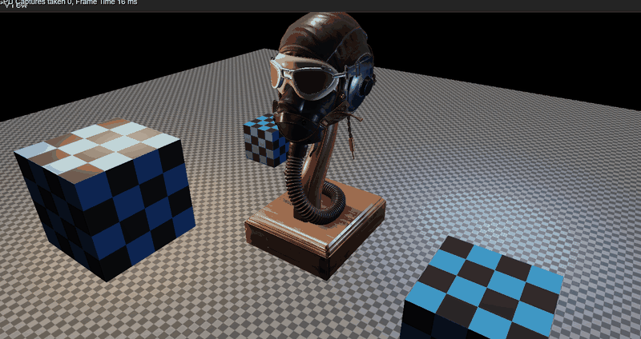
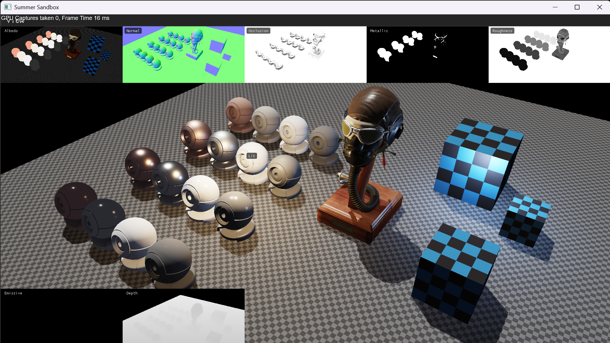
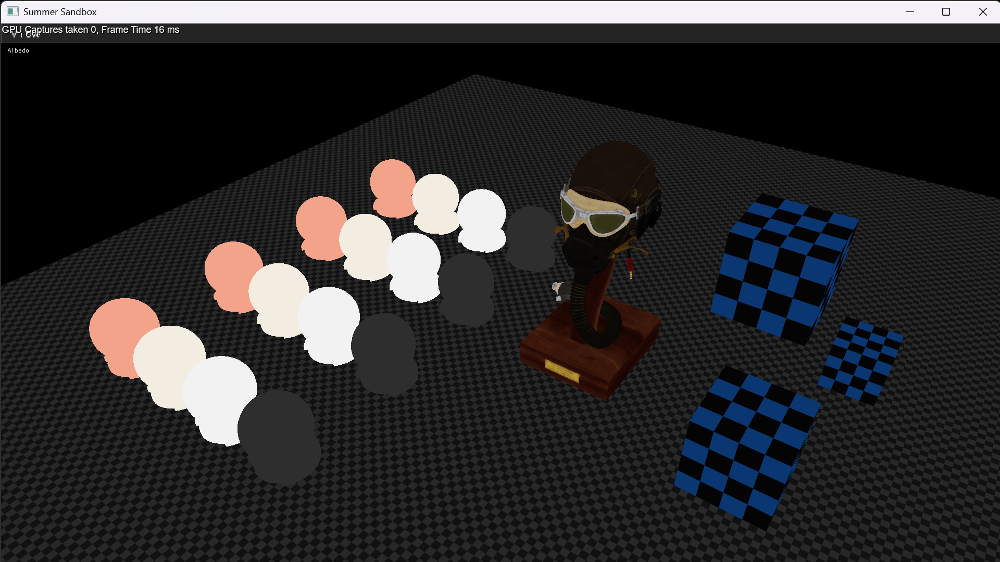
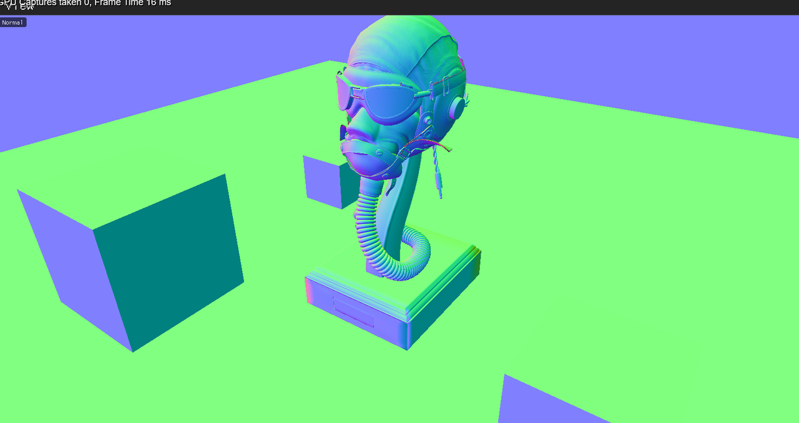
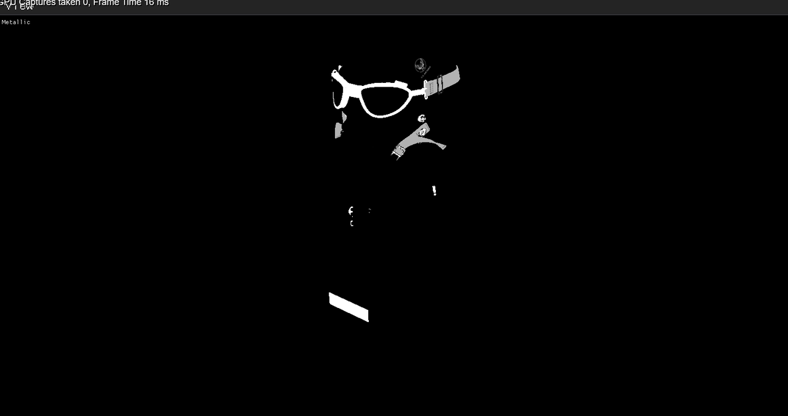
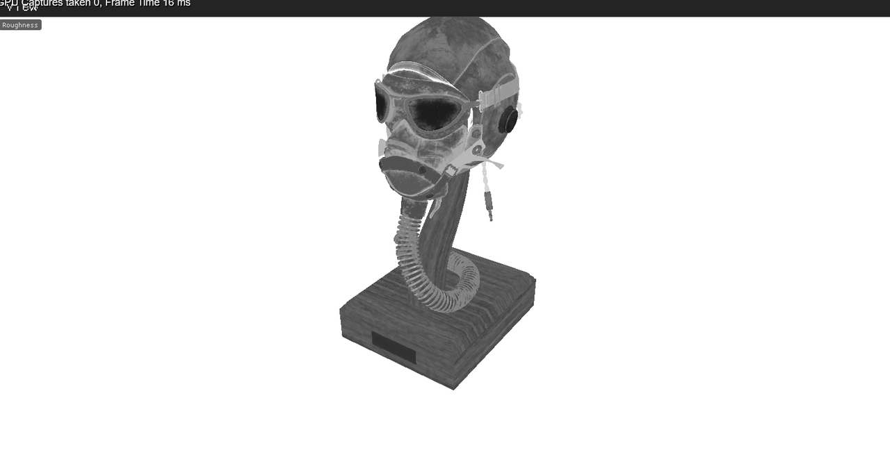
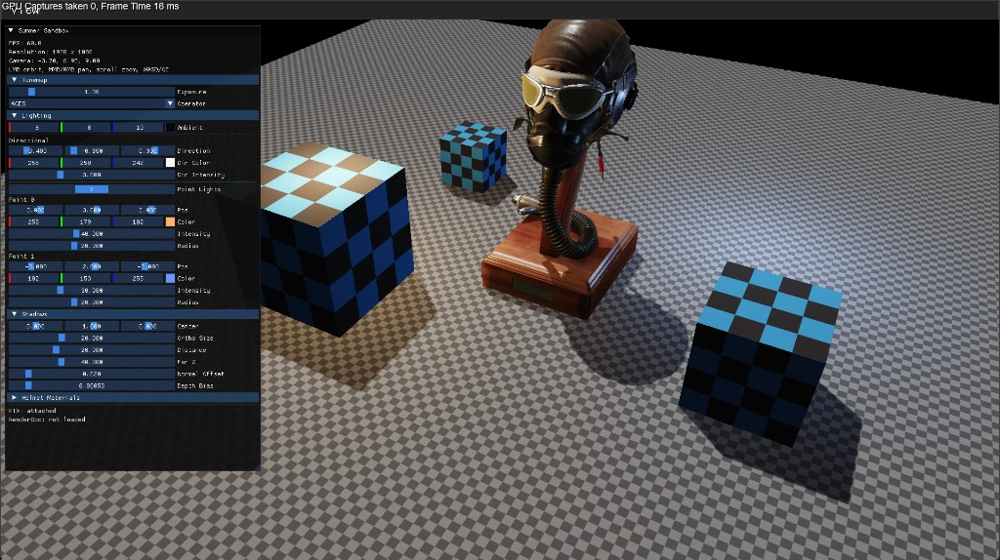
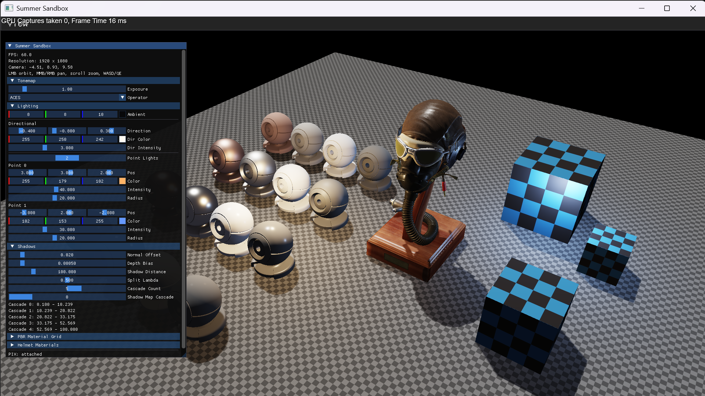

# SummerEngine

A from-scratch **Direct3D 12** renderer — no engine middleware, no Unreal, no Unity. I use it to study rendering tech at the API level, keep the inner workings of a deferred frame visible, and show the kind of graphics systems I already build professionally.

Opaque geometry is deferred: a depth-only shadow pass renders the sun's shadow map, a G-buffer is filled, a fullscreen pass lights it with Cook–Torrance PBR (with PCF-filtered sun shadows) into an HDR target, then a tonemap resolve hits the swapchain. GPU
resources, descriptors, pipeline states, synchronization, and render-pass sequencing are managed explicitly through
Direct3D 12.

<p align="center">
  
</p>

<p align="center">
  <em>Khronos FlightHelmet + procedural ground/cubes. Directional + point lights, ACES tonemap.
  The yellow HUD is PIX when its GPU capturer is loaded.</em>
</p>

---

## Why this exists

I wanted a renderer I fully own, so I can try ideas and see how the thing actually works. Notes on how it's put together: [`docs/ARCHITECTURE.md`](docs/ARCHITECTURE.md).

---

## Features

| | |
|---|---|
| **Deferred PBR** | Geometry writes a G-buffer; lighting is a fullscreen pass that reuses a shared Cook–Torrance BRDF (`PbrCommon.hlsli`). |
| **Directional shadows** | A depth-only pass renders the sun's shadow map. Deferred lighting compares against it with 3×3 PCF. Ambient, emissive, and point lights stay unshadowed. |
| **HDR + tonemap** | Scene radiance is `R16G16B16A16_FLOAT`, then ACES or Reinhard + gamma onto an UNORM backbuffer. |
| **Debug views** | **View** menu in the same spirit as UE: Lit, a G-buffer Overview, packed channels (albedo, world normal, occlusion, metal, roughness, emissive, depth), and the shadow map. |
| **glTF / Assimp import** | Multi-material FlightHelmet (base color, normal, ORM, occlusion, emissive) plus procedural meshes. |
| **D3D12 resource layer** | `GpuTexture`, `RenderTarget`, `DepthStencil`, RAII descriptors, global RTV/DSV/SRV heaps. |
| **PIX / RenderDoc** | Same capture workflow I use on shipped titles: standalone launch, exe-relative assets, F11 for RenderDoc. |

<p align="center">
  
</p>

<p align="center">
  <em>Default Lit view — deferred lighting into HDR, ACES tonemap to the swapchain.</em>
</p>

---

## G-buffer visualization

The Overview mode keeps Lit in the center of a 5×5 frame and packs the individual targets around it, the same idea as Unreal’s buffer visualization.

<p align="center">
  
</p>

<p align="center">
  
</p>

Packed attachments, not one RT per slider:

| Target | Format | Contents |
|---|---|---|
| Albedo | `R8G8B8A8_UNORM` | RGB albedo, **A occlusion** |
| Normal | `R16G16B16A16_FLOAT` | World-space normals (signed) |
| Material | `R8G8B8A8_UNORM` | R metallic, G roughness, B emissive luminance |
| Depth | `D32` + `R32` SRV | Hardware depth; lighting reconstructs world position |

<p align="center">
  
  
</p>
<p align="center">
  
  
</p>

World position is not stored. The lighting shader rebuilds it from depth and `invViewProj` (with the D3D NDC Y flip).

---

## Rendering Pipeline

```text
shadow pass  →  shadow map (depth from the sun)
geometry     →  G-buffer (MRT + depth)
      ↘
        deferred lighting (sun term × shadow)  →  HDR  →  tonemap  →  backbuffer  →  ImGui
      ↗
G-buffer SRVs and the shadow map also feed DebugViewPipeline (full-screen or overview tiles)
```

<p align="center">
  
</p>

<p align="center">
  <em>Directional shadow map with 3×3 PCF. The Shadows panel fits the light box and the bias. The yellow HUD is PIX.</em>
</p>

This is manually scheduled, not yet a general-purpose render-graph abstraction.
`PbrPipeline` (forward) is still created so a later translucency pass can reuse it. It is **not** the live opaque path.

<p align="center">
  
</p>

<p align="center">
  <em>Runtime controls: exposure, tonemap operator, directional + point lights, per-material metal/roughness.</em>
</p>

---

## Stack

- **API:** Direct3D 12, DXGI flip model, Root Signature 1.1
- **Shaders:** HLSL 6.0, DXC, PIX/RenderDoc PDBs
- **Window / UI:** GLFW (HWND only — no GL context) + Dear ImGui 1.92
- **Assets:** Assimp 6.x (glTF, OBJ, …), stb_image, Khronos FlightHelmet
- **Build:** Premake5 → VS 2026 / MSVC v145

---

## Code Highlights

For anyone interested in the implementation, these are good starting points:

| System | Implementation | What to look for |
|---|---|---|
| **Frame execution** | [`Renderer`](src/Engine/Gfx/Renderer.cpp) | Pass sequencing, command recording, resource transitions, and frame synchronization |
| **G-buffer** | [`GBuffer`](src/Engine/Gfx/GBuffer.cpp) · [`GBufferPS.hlsl`](shaders/GBufferPS.hlsl) | Multiple render targets, PBR material packing, and sampleable depth |
| **Deferred lighting** | [`DeferredLightingPipeline`](src/Engine/Gfx/DeferredLightingPipeline.cpp) · [`DeferredLightingPS.hlsl`](shaders/DeferredLightingPS.hlsl) | Fullscreen lighting, world-position reconstruction, PBR evaluation, and the shadow lookup |
| **Shadows** | [`ShadowPipeline`](src/Engine/Gfx/ShadowPipeline.cpp) · [`ShadowVS.hlsl`](shaders/ShadowVS.hlsl) | Depth-only pass from the sun; PCF and bias live in `DeferredLightingPS.hlsl` |
| **PBR shading** | [`PbrCommon.hlsli`](shaders/PbrCommon.hlsli) | Shared Cook–Torrance BRDF implementation |
| **GPU resources** | [`GpuTexture`](src/Engine/Gfx/GpuTexture.cpp) · [`GpuDescriptorHeap`](src/Engine/Gfx/GpuDescriptorHeap.cpp) | Resource ownership, descriptor allocation, and explicit D3D12 management |
| **Tonemapping** | [`TonemapPS.hlsl`](shaders/TonemapPS.hlsl) | HDR-to-backbuffer conversion, exposure, and tone mapping |
| **Debug visualization** | [`DebugViewPS.hlsl`](shaders/DebugViewPS.hlsl) | G-buffer inspection and fullscreen debug views |

For a more detailed explanation of resource ownership, root signatures, synchronization, and the rendering pipeline, see [ARCHITECTURE.md](docs/ARCHITECTURE.md).

---

## Engineering Decisions & Tradeoffs

SummerEngine is both a rendering engine and a place to explore graphics architecture. Some design choices prioritize
simplicity and experimentation today, while leaving room for more advanced techniques as the engine evolves.

### Deferred Rendering and Future Hybrid Architecture

SummerEngine currently uses deferred rendering for its main opaque geometry path. This provides a foundation for
experimenting with advanced rendering techniques, including a planned Nanite-like micropolygon rasterizer, which I
intend to explore using a deferred approach initially.

I don't consider deferred rendering inherently superior to forward rendering. Both have advantages depending on scene
complexity, lighting requirements, hardware, and memory constraints. In my professional experience with AAA open-world
rendering, memory pressure is often as significant a concern as frame time, and deferred rendering's additional render
targets and bandwidth requirements are important tradeoffs.

I've also studied forward-oriented architectures, particularly through id Software's technical presentations, which
demonstrate how effective a carefully designed forward renderer can be.

My long-term goal is a hybrid architecture supporting deferred and Forward+ rendering, allowing me to experiment with
different approaches and choose the most appropriate path for each rendering feature.

### Explicit Resource Ownership and GPU Synchronization

SummerEngine uses explicit D3D12 resource management with RAII-based wrappers, descriptor allocators, and manually
tracked resource-state transitions.

Frame execution uses per-back-buffer fences, allowing CPU and GPU work to overlap without unnecessarily draining the GPU
every frame. Each back-buffer slot is synchronized before its command allocator and per-frame resources are reused. Full
GPU synchronization is reserved for operations such as shutdown, resizing, and one-shot uploads.

The current resource wrappers release their D3D12 references when their C++ owners are destroyed. This keeps ownership
straightforward, but it also means resource destruction must be coordinated with outstanding GPU work. Per-back-buffer
fences protect frame-resource reuse; they do not automatically guarantee that an arbitrary texture or descriptor is no
longer referenced by another in-flight frame.

As the engine grows toward dynamic resource streaming and runtime asset replacement, I plan to introduce fence-based
deferred destruction for GPU resources and descriptor allocations. This will allow CPU-side owners to release resources
without prematurely invalidating objects still referenced by the GPU or requiring a full GPU stall for every
destruction.

### Explicit Pass Scheduling and a Future Render Graph

SummerEngine currently records its rendering passes explicitly inside `Renderer::RenderFrame()`, with manually managed
resource transitions between the shadow pass, geometry, deferred lighting, tonemapping, and debug/UI rendering.

For the current pipeline, this keeps execution order and resource usage easy to inspect and debug without adding
unnecessary abstractions.

As I add cascaded shadows, additional lighting passes, post-processing, temporal effects, and more intermediate
resources, manually managing dependencies and transitions will become increasingly complex.

I plan to introduce an API-agnostic render graph as I expand the engine toward Vulkan. The graph would describe passes
and their resource dependencies independently of the graphics API, while backend-specific implementations would handle
barriers, synchronization, and resource allocation.

Beyond simplifying pass management, this should provide opportunities for transient resource reuse, lifetime analysis,
and memory optimization—particularly important given the memory constraints I've encountered in production rendering.

---

## GPU Profiling & Debugging

SummerEngine is designed to support inspection and debugging of its rendering pipeline using **PIX** and **RenderDoc**.

- **PIX:** GPU capture support is initialized before D3D12 device creation, allowing external GPU captures and
  inspection of rendering commands.
- **RenderDoc:** Supports frame captures when launched through RenderDoc, including an F11 capture shortcut.
- **D3D12 Debug Layer:** Enabled in debug builds to help identify resource-state, descriptor, and API usage errors.
- **Debug views:** Runtime inspection of albedo, normals, depth, packed material channels, and the shadow map helps
  diagnose rendering and shading issues.
---

### Frame inspection

The current rendering path provides four main stages for GPU inspection:

1. **Shadow pass:** Draws opaque geometry into a depth-only shadow map from the sun's point of view.
2. **Geometry pass:** Draws opaque geometry into the G-buffer and sampleable depth target.
3. **Deferred lighting pass:** Samples the G-buffer and the shadow map, and evaluates PBR lighting into an HDR render target.
4. **Tonemapping pass:** Resolves the HDR result to the swapchain backbuffer.

The engine manages resource-state transitions and command recording explicitly, making it possible to follow resource
usage across these stages.

### Performance measurements

Reproducible GPU timings and capture comparisons will be added as the renderer evolves. No production-performance claims
are made for the current sandbox implementation.

---

## Download & Run

Want to try SummerEngine without building it from source?

A prebuilt Windows demo is available on
the [GitHub Releases page](https://github.com/RomanovV/SummerEngine/releases/latest).

Download the latest release, extract it, and launch `Sandbox.exe`.

To compile the engine yourself or explore its implementation, follow the build instructions below.

---

## Controls

| Input | Action |
|---|---|
| LMB drag | Orbit |
| MMB / RMB drag | Pan |
| Scroll, Q / E | Zoom |
| WASD | Pan |
| **View** menu | Lit, G-buffer modes, shadow map |
| F1–F9 | Lit, Overview, Albedo, Normal, Occlusion, Metallic, Roughness, Emissive, Depth |
| H | Toggle the sandbox panel |
| F11 | RenderDoc capture (if attached) |

---

## Build

Windows, Visual Studio 2026, a recent Windows SDK with DXC.

```powershell
git clone --recurse-submodules https://github.com/RomanovV/SummerEngine.git
cd SummerEngine

.\scripts\build_assimp.ps1
.\vendor\premake\premake5.exe vs2026
msbuild build\SummerEngine.slnx /p:Configuration=Debug /p:Platform=x64
.\build\bin\Debug\Sandbox.exe
```

Shaders compile in a prebuild step (`scripts/compile_shaders.ps1`). Assets and `.cso` files are staged next to the exe (`scripts/stage_assets.ps1`) so PIX and RenderDoc can launch it without a special working directory.

Debug builds define `SUMMER_DEBUG` and enable the D3D12 debug layer.

---

## Roadmap

Built so far: resource/descriptor layer, forward PBR (kept), deferred PBR, HDR tonemap, G-buffer debug views, directional shadow map with 3×3 PCF.

**Next:** cascaded shadow maps. After that: tiled lights, instancing, foliage (alpha test in the G-buffer), translucency on the forward path.

Details and file-level hook points: [`docs/ARCHITECTURE.md`](docs/ARCHITECTURE.md).
