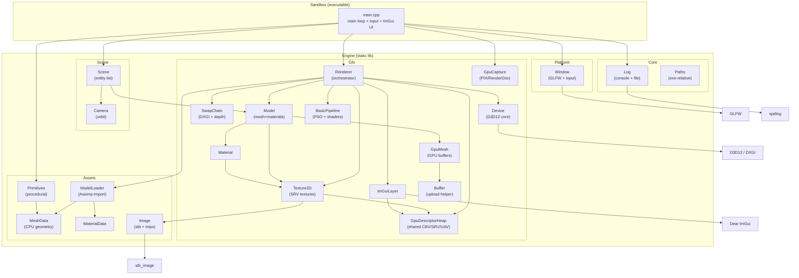
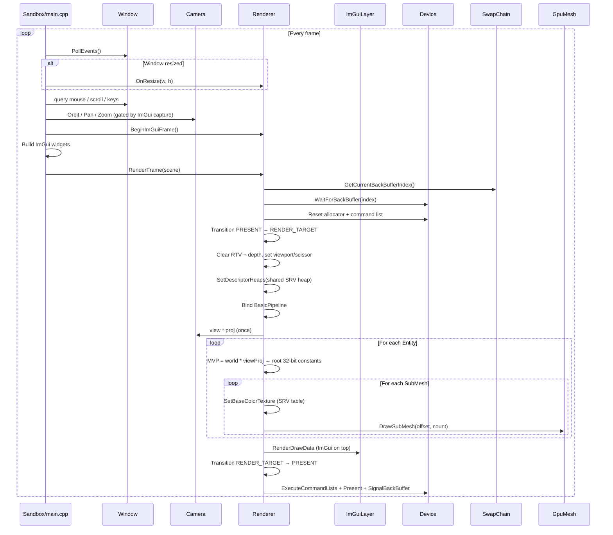
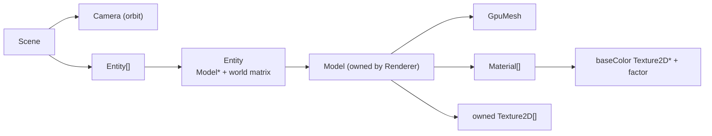
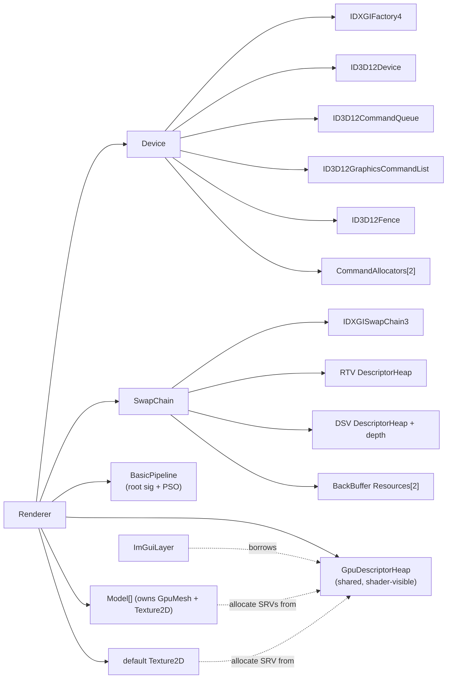
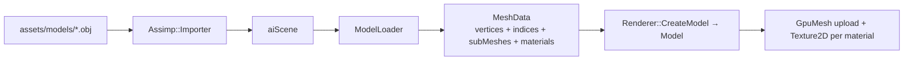

# SummerEngine Architecture

> Sandbox rendering engine for learning and experimenting with D3D12, shaders, and rendering techniques.
> This document reflects the codebase as of **Phase 1** (multi-mesh models, materials, minimal scene + orbit camera).

---

## High-Level Overview

SummerEngine is split into two build targets:

| Target | Type | Role |
|---|---|---|
| **Engine** | Static library | All reusable boilerplate (platform, D3D12, assets, scene, ImGui) |
| **Sandbox** | Console executable | Thin entry point; hosts experiment UI and the main loop |

Third-party code lives in `vendor/` as git submodules. Build is driven by **Premake5** generating a VS 2022 solution.

```
SummerEngine/
├── premake5.lua            # Build configuration
├── docs/                   # Architecture and design notes
├── scripts/                # Shader compile + asset staging (PowerShell)
├── src/
│   ├── Engine/             # Static lib (summer:: / gfx:: / assets:: / scene::)
│   │   ├── Core/           # Log, Paths
│   │   ├── Platform/       # Window (GLFW)
│   │   ├── Assets/         # MeshData, MaterialData, ModelLoader, Image, Primitives
│   │   ├── Gfx/            # Device, SwapChain, Renderer, pipelines, textures, models
│   │   └── Scene/          # Camera, Scene (entity list)
│   └── Sandbox/            # main.cpp
├── shaders/                # HLSL (BasicVS/BasicPS) → compiled to .cso
├── assets/models/          # Meshes via Assimp (e.g. cube.obj)
└── vendor/                 # GLFW, ImGui, spdlog, stb, Assimp, renderdoc (+ premake)
```

Compiled shaders and assets are **staged next to the executable** (`scripts/stage_assets.ps1`) so the
build runs standalone — important for launching under RenderDoc / PIX, which set their own working directory.

---

## Module Diagram



---

## Namespace Layout

| Namespace | Modules | Purpose |
|---|---|---|
| `summer::` | `Log`, `Paths`, `Window` | Platform-agnostic engine utilities |
| `summer::gfx::` | `Device`, `SwapChain`, `Renderer`, `ImGuiLayer`, `GpuDescriptorHeap`, `BasicPipeline`, `GpuMesh`, `Buffer`, `Texture2D`, `Material`, `Model`, `GpuCapture` | All D3D12 rendering code |
| `summer::assets::` | `MeshData`, `MaterialData`, `ModelLoader`, `Image`, `Primitives` | CPU-side geometry / materials / images |
| `summer::scene::` | `Scene`, `Entity`, `Camera` | Minimal scene graph (draw list + camera) |

---

## Initialization Order

Startup sequence in `Sandbox/main.cpp`:

```
1. Log::Init()                       → console + timestamped .log file
2. GpuCapture::LoadCaptureTools()    → load WinPixGpuCapturer / grab RenderDoc API (BEFORE device)
3. Window creation                   → GLFW window + HWND
4. Renderer::Initialize(window)
   ├── Device::Initialize()          → DXGI factory, D3D12 device, queue, fence
   ├── SwapChain::Initialize()       → swap chain bound to HWND, RTV heap, depth + DSV
   ├── GpuDescriptorHeap::Initialize()→ shared shader-visible CBV/SRV/UAV heap
   ├── Texture2D (default checker)    → placeholder base color
   ├── BasicPipeline::Initialize()   → root signature + PSO from compiled .cso
   └── ImGuiLayer::Initialize()      → ImGui context, GLFW+DX12 backends (borrows the shared heap)
5. GpuCapture::SetActiveWindow()     → associates RenderDoc overlay with device + window
6. Create textures / models          → Renderer::CreateTexture / CreateModel / LoadModel
7. Build Scene                       → add entities (model + transform), configure Camera
8. Main loop
```

Shutdown is the reverse, with `Device::WaitForGpu()` first to drain in-flight frames. Models and
textures free their SRV slots, so they are released **before** the shared descriptor heap.

---

## Per-Frame Flow

This is the most important loop to understand when adding rendering experiments.



### Per-object constants (why root constants)

A single mapped constant buffer can't hold distinct per-entity data within one frame — every draw
would observe the last value written, since the GPU executes the command list later. So the per-object
MVP is pushed as **32-bit root constants** (16 floats at `b0`). This keeps multi-entity rendering
correct with no ring buffer. As per-object data grows (normal matrix, material params), this migrates
to a proper per-object constant ring / structured buffer.

### Where to hook your experiments

| What you want to do | Where to put it |
|---|---|
| UI toggles, debug values | `Sandbox/main.cpp` (between `BeginImGuiFrame` and `RenderFrame`) |
| Scene content (models, transforms, camera) | `Sandbox/main.cpp` scene setup + `Scene/` |
| New render passes / techniques | `Renderer::RenderFrame()` or new methods called from there |
| Shader / PSO experiments | New files under `Gfx/` + `shaders/` |
| Asset loading / mesh import | `Assets/ModelLoader` → `MeshData` (+ `MaterialData`) |
| Procedural geometry | `Assets/Primitives` |
| Textures / images | `Assets/Image` (CPU) + `Gfx/Texture2D` (GPU) |

---

## Scene & Rendering Model



- **`Scene`** is intentionally minimal: a `Camera` plus a flat `std::vector<Entity>`. No hierarchy or
  serialization yet — a draw list is all you need to study rendering.
- **`Entity`** references a borrowed `Model*` (owned by the `Renderer`) plus a row-major world matrix.
- **`Model`** owns one `GpuMesh` (which may contain several submeshes), its imported `Texture2D`s, and
  a resolved `Material` per imported material. `Model::Draw` binds the mesh once and draws each submesh
  with its material's base color (falling back to a borrowed default checkerboard).
- **`Camera`** is an orbit camera (yaw / pitch / distance around a target) producing left-handed
  view + perspective matrices. Controlled from `main.cpp`: LMB orbit, MMB/RMB pan, scroll zoom, WASD/QE.

The **`Renderer`** owns the GPU-side resource pools (`std::vector<std::unique_ptr<Model>>` and
`Texture2D`) and exposes `CreateTexture` / `CreateModel` / `LoadModel`. `RenderFrame(const Scene&)`
walks the entity list and draws per submesh.

---

## D3D12 Object Ownership



### Key constants

- **`FrameCount = 2`** — double-buffered swap chain. Defined in `Device.h`, used by `SwapChain`.
- **`kSrvHeapCapacity = 1024`** — shared shader-visible CBV/SRV/UAV heap (ImGui font + engine textures).
  Defined in `Renderer.cpp`; grow as content grows.

### BasicPipeline root signature

| Slot | Binding | Purpose |
|---|---|---|
| Root param 0 | 32-bit constants `b0` (16 floats) | Per-object MVP |
| Root param 1 | Descriptor table, SRV `t0` | Base color texture |
| Static sampler | `s0` (trilinear, wrap) | No separate sampler heap needed |

---

## GPU Synchronization Model

D3D12 has no implicit sync. SummerEngine uses a **fence per back buffer**:

1. Before recording into back buffer `N`, check the GPU finished the previous frame that used `N` (`WaitForBackBuffer`).
2. Record commands, execute, present.
3. Signal the fence with a monotonically increasing value (`SignalBackBuffer`).

Full GPU drain (`WaitForGpu`) is used only at shutdown, resize, and one-shot uploads (mesh/texture) —
expensive, but required before destroying/resizing GPU resources or freeing upload staging buffers.

---

## Descriptor Heaps

D3D12 uses descriptor heaps instead of bind slots. SummerEngine currently has three:

| Heap | Type | Owner | Shader-visible? | Purpose |
|---|---|---|---|---|
| RTV heap | `..._RTV` | `SwapChain` | No | Back buffer render target views |
| DSV heap | `..._DSV` | `SwapChain` | No | Depth-stencil for the 3D pass |
| SRV heap | `..._CBV_SRV_UAV` | `Renderer` (`GpuDescriptorHeap`) | **Yes** | ImGui font atlas + all engine textures |

> **Important:** Only one shader-visible CBV/SRV/UAV heap can be bound per command list. ImGui and all
> engine `Texture2D`s therefore **share** the single `GpuDescriptorHeap`, which uses a free-list
> allocator. ImGui 1.92+ requires app-provided alloc/free callbacks, which route into the same heap.

---

## Asset Import Pipeline



`ModelLoader` walks the scene graph, applies node transforms, and merges meshes into flat CPU arrays
while preserving **submeshes** (each with its `materialIndex`). It also imports **materials**: base
color factor (`AI_MATKEY_BASE_COLOR` → diffuse fallback) and base color texture (`BASE_COLOR` →
`DIFFUSE`), resolving texture paths relative to the model file.

`Renderer::CreateModel` uploads geometry via `GpuMesh` and loads each unique material texture via
`Texture2D` (deduplicated by path), falling back to a borrowed default texture where none exists.
Procedural geometry (e.g. `Primitives::MakePlane`) produces the same `MeshData` and goes through the
same path.

Shaders (`shaders/BasicVS.hlsl`, `shaders/BasicPS.hlsl`) are yours to experiment with; the C++ side
loads compiled `.cso` bytecode (with embedded PDBs for PIX/RenderDoc shader debugging).

---

## GPU Capture Tools

`Gfx/GpuCapture` provides best-effort integration with **PIX** and **RenderDoc**:

- **PIX** — `LoadCaptureTools()` (called before device creation) loads the newest
  `WinPixGpuCapturer.dll` so PIX can attach to a standalone launch.
- **RenderDoc** — when launched through the RenderDoc UI, grabs the in-application API;
  `TriggerRenderDocCapture()` (F11 in the sandbox) queues a capture of the next frame.

All functions are no-ops when the corresponding tool isn't present. `Core/Paths` resolves resources
relative to the executable so captures work regardless of the launcher's working directory.

---

## Build System

```
premake5.lua
├── GLFW       (static lib, C)
├── ImGui      (static lib, C++ — core + glfw/dx12 backends)
├── Engine     (static lib, C++ — links GLFW + ImGui + Assimp)
└── Sandbox    (console app, links Engine)
```

**Assimp** is built separately via CMake (vendor-only) because it does not ship a Premake script:

```powershell
.\scripts\build_assimp.ps1
```

Generate and build:

```powershell
.\vendor\premake\premake5.exe vs2022
msbuild build\SummerEngine.sln /p:Configuration=Debug /p:Platform=x64
.\build\bin\Debug\Sandbox.exe
```

- Shaders compile via a **prebuild** step (`scripts/compile_shaders.ps1`, DXC → `build/shaders/`).
- Shaders + assets are copied next to the exe via a **postbuild** step (`scripts/stage_assets.ps1`).
- Debug builds define `SUMMER_DEBUG`, which enables the D3D12 debug layer.

---

## Vendor Dependencies

| Library | Submodule path | Used for |
|---|---|---|
| GLFW 3.4 | `vendor/glfw` | Window, input, Win32 HWND |
| Dear ImGui | `vendor/imgui` | Debug UI, experiment controls |
| spdlog | `vendor/spdlog` | Logging (header-only) |
| stb | `vendor/stb` | Image loading (`stb_image`) |
| Assimp 6.x | `vendor/assimp` | Mesh + material import (OBJ, FBX, glTF, …) |
| RenderDoc API | `vendor/renderdoc` | In-application capture header |

---

## Roadmap

Long-term, this is a sandbox for studying rendering techniques. Phases are ordered so each builds on
the previous with the least rework; dependencies are noted where ordering is flexible.

### ✅ Phase 0 — Framework fundamentals *(done)*
File logging to `.log` (console + timestamped file), `Image` loading (stb) + mip generation,
`Texture2D` GPU upload + SRV, a **shared** shader-visible descriptor heap, `Material` + base-color
binding on the root signature, and standalone launch support for PIX/RenderDoc (`Paths`, `GpuCapture`).

### ✅ Phase 1 — Multi-mesh + minimal scene *(done)*
Per-submesh draw ranges, `Model` (owns mesh + resolved materials/textures), material/texture **import**
from Assimp, a flat `Scene` (entity list) + orbit `Camera`, per-object MVP via root constants, and a
procedural textured plane + loaded cubes in the sandbox.

### ⬜ Phase 2 — PBR (forward)
Cook–Torrance metallic-roughness, tangent-space normal mapping (Assimp can generate tangents), one
directional + a few point lights. Validate here where debugging is easy.
- *Optional sub-step:* IBL — cubemap load + irradiance / prefilter / BRDF-LUT. Can be deferred.

### ⬜ Phase 3 — Deferred rendering
G-buffer (albedo / normal / metallic-roughness / depth) + a fullscreen lighting pass that **reuses the
exact BRDF** from Phase 2 (so it's a port, not a rewrite). Makes many lights cheap.

### ⬜ Phase 4 — Shadows
Directional shadow map (depth-only pass + PCF) sampled in the deferred lighting pass; then cascaded
shadow maps. Point/omni shadows later. Needs Phase 1's multiple casters/receivers.

### ⬜ Phase 5 — GPU instancing
Instanced draw of many copies of a mesh (per-instance transforms via a structured/vertex buffer,
`DrawIndexedInstanced`), plus optional GPU/indirect culling. **Depends only on Phase 1** and is
largely orthogonal — it can be pulled earlier — but it lands here because Foliage and GPU VFX lean on
it heavily (grass fields, debris) and it pairs well with the deferred path.

### ⬜ Phase 6 — Foliage (alpha-masked)
Alpha test in the G-buffer pass (deferred-friendly, unlike blending), two-sided rendering, optional
alpha-to-coverage. Depends on textures + deferred; benefits from instancing.

### ⬜ Phase 7 — Translucency
Forward transparent pass after the deferred resolve — back-to-front sorting, blend states, reusing the
forward PBR shader. This is *why* the forward path stays around; alpha blending can't live in the G-buffer.

### ⬜ Phase 8 — Volumetric fog
Height/uniform fog, raymarched or froxel-based, reading depth and **shadow maps** for light shafts.
Naturally sits after shadows; benefits from compute.

### ⬜ Phase 9 — GPU VFX (particles)
Compute-driven particles: structured buffers, simulation in compute, indirect draw, sorted transparent
rendering. Builds on the compute touched in volumetrics and the translucency pass. Fairly orthogonal,
but last makes sense since it leans on the most infrastructure.

### Dependency summary

```
Phase 0 (logging/textures/heap) ─┐
Phase 1 (multi-mesh + scene) ────┼─→ Phase 2 PBR(fwd) ─→ Phase 3 Deferred ─→ Phase 4 Shadows ─→ Phase 8 Volumetrics
                                 │                             │       │
                                 ├─────────────────→ Phase 5 GPU instancing ─┐
                                 │                             ├─→ Phase 6 Foliage
                                 │                             └─→ Phase 7 Translucency ─→ Phase 9 GPU particles
```

Ordering rationale:
- **Forward PBR before deferred** — debug the BRDF with minimal state, then the deferred light pass reuses it.
- **Shadows after deferred** — write shadow sampling once, in the light pass.
- **Keep the forward path** — translucency and particles depend on it existing.
- **Instancing is orthogonal** — only needs the Phase 1 draw list; slotted before Foliage since foliage relies on it.
- **Scene stays minimal** until later; you don't need serialization to learn rendering, just a draw list + camera.

---

## File Quick Reference

| File | Read this when… |
|---|---|
| `Sandbox/main.cpp` | You want to add UI, change the main loop, or edit the scene/camera controls |
| `Gfx/Renderer.cpp` | You want to add render passes, resource pools, or change frame flow |
| `Gfx/Device.cpp` | You need to understand GPU sync or add D3D12 objects |
| `Gfx/SwapChain.cpp` | You need to change presentation or the depth/stencil target |
| `Gfx/GpuDescriptorHeap.cpp` | You allocate SRVs/CBVs/UAVs from the shared shader-visible heap |
| `Gfx/ImGuiLayer.cpp` | You need to debug UI rendering or the shared-heap callbacks |
| `Gfx/BasicPipeline.cpp` | You change the root signature, PSO, or per-object constants |
| `Gfx/GpuMesh.cpp` | You change buffer upload or per-submesh draw setup |
| `Gfx/Model.cpp` | You change how a model resolves materials/textures or draws |
| `Gfx/Texture2D.cpp` | You change GPU texture creation / mip upload / SRV setup |
| `Gfx/GpuCapture.cpp` | You work on PIX/RenderDoc integration |
| `Assets/ModelLoader.cpp` | You change mesh/material import |
| `Assets/Image.cpp` | You change CPU image loading / mip generation / procedural textures |
| `Assets/Primitives.cpp` | You add procedural geometry |
| `Scene/Camera.cpp` | You change camera behavior or projection |
| `Scene/Scene.h` | You change the entity/draw-list model |
| `shaders/BasicVS.hlsl` | Vertex shader experiments |
| `shaders/BasicPS.hlsl` | Pixel shader / lighting experiments |
| `premake5.lua` | You add source files, libs, or build steps |
```
