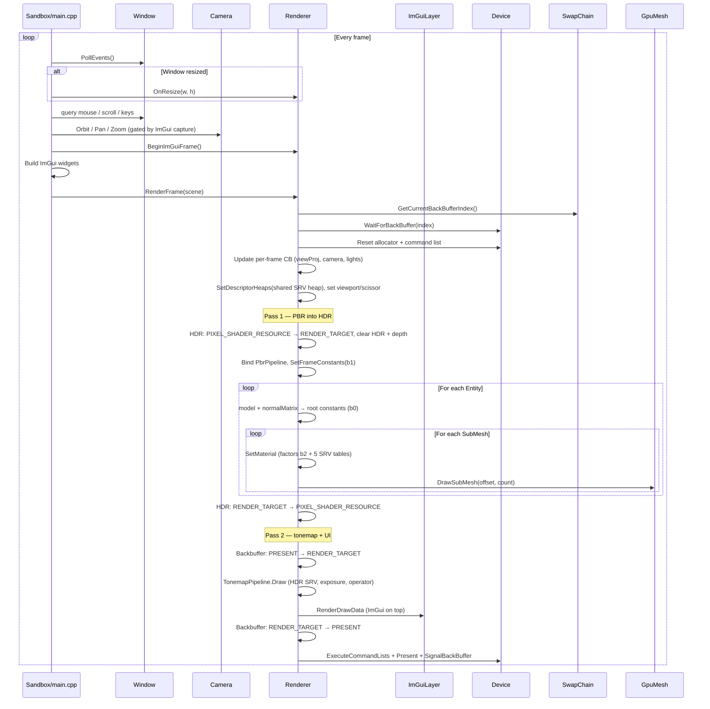
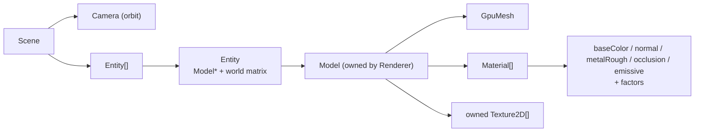
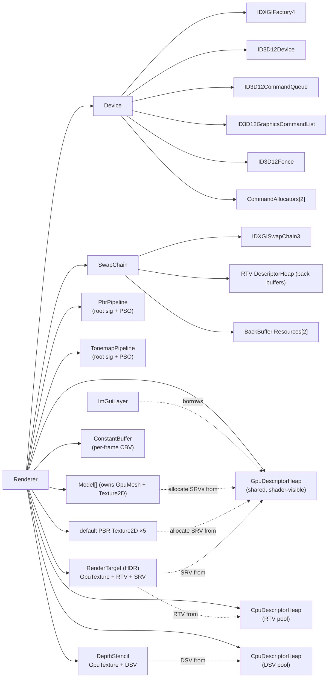
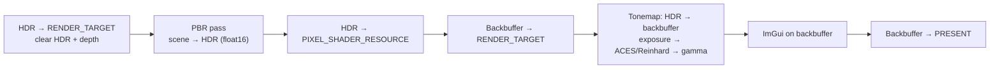
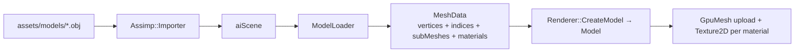

# SummerEngine Architecture

> Sandbox rendering engine for learning and experimenting with D3D12, shaders, and rendering techniques.
> This document reflects the codebase as of **Phase 3** (deferred PBR: G-buffer + fullscreen lighting
> into the HDR target, then tonemap). The forward `PbrPipeline` remains for later translucency.

---

## High-Level Overview

SummerEngine is split into two build targets:

| Target | Type | Role |
|---|---|---|
| **Engine** | Static library | All reusable boilerplate (platform, D3D12, assets, scene, ImGui) |
| **Sandbox** | Console executable | Thin entry point; hosts experiment UI and the main loop |

Third-party code lives in `vendor/` as git submodules. Build is driven by **Premake5** generating a VS 2026 solution (MSVC toolset v145).

```
SummerEngine/
├── premake5.lua            # Build configuration
├── docs/                   # Architecture and design notes
├── scripts/                # Shader compile + asset staging (PowerShell)
├── src/
│   ├── Engine/             # Static lib (summer:: / gfx:: / assets:: / scene::)
│   │   ├── Core/           # Log, Paths
│   │   ├── Platform/       # Window (GLFW)
│   │   ├── Assets/         # MeshData, MaterialData, ModelLoader, Image, Primitives
│   │   ├── Gfx/            # Device, SwapChain, Renderer, pipelines, resources (RenderTarget/DepthStencil/GpuTexture), descriptors
│   │   └── Scene/          # Camera, Scene (entity list)
│   └── Sandbox/            # main.cpp
├── shaders/                # HLSL (PbrVS/PbrPS, FullscreenVS/TonemapPS) → compiled to .cso
├── assets/models/          # Meshes via Assimp (cube.obj, FlightHelmet glTF)
└── vendor/                 # GLFW, ImGui, spdlog, stb, Assimp, renderdoc (+ premake)
```

Compiled shaders and assets are **staged next to the executable** (`scripts/stage_assets.ps1`) so the
build runs standalone — important for launching under RenderDoc / PIX, which set their own working directory.

---

## Module Diagram

```mermaid
graph TB
    subgraph Sandbox["Sandbox (executable)"]
        Main["main.cpp<br/>main loop + input + ImGui UI"]
    end

    subgraph Engine["Engine (static lib)"]
        subgraph Core["Core"]
            Log["Log<br/>(console + file)"]
            Paths["Paths<br/>(exe-relative)"]
        end

        subgraph Platform["Platform"]
            Window["Window<br/>(GLFW + input)"]
        end

        subgraph Scene["Scene"]
            SceneObj["Scene<br/>(entity list)"]
            Camera["Camera<br/>(orbit)"]
        end

        subgraph Gfx["Gfx"]
            Renderer["Renderer<br/>(orchestrator)"]
            Device["Device<br/>(D3D12 core)"]
            SwapChain["SwapChain<br/>(DXGI back buffers)"]
            ImGuiLayer["ImGuiLayer"]
            SrvHeap["GpuDescriptorHeap<br/>(shared CBV/SRV/UAV)"]
            RtvDsvHeaps["CpuDescriptorHeap ×2<br/>(RTV + DSV pools)"]
            Model["Model<br/>(mesh+materials)"]
            GpuMesh["GpuMesh<br/>(GPU buffers)"]
            Texture2D["Texture2D<br/>(SRV textures)"]
            Material["Material<br/>(PBR slots + factors)"]
            PbrPipeline["PbrPipeline<br/>(PSO + PBR shaders)"]
            TonemapPipeline["TonemapPipeline<br/>(fullscreen resolve)"]
            RenderTarget["RenderTarget<br/>(GpuTexture + RTV + SRV)"]
            DepthStencil["DepthStencil<br/>(GpuTexture + DSV [+SRV])"]
            GpuTexture["GpuTexture<br/>(resource + state/barriers)"]
            ConstantBuffer["ConstantBuffer<br/>(per-frame CB)"]
            Lighting["Lighting<br/>(FrameConstants)"]
            Buffer["Buffer<br/>(upload helper)"]
            GpuCapture["GpuCapture<br/>(PIX/RenderDoc)"]
        end

        subgraph Assets["Assets"]
            ModelLoader["ModelLoader<br/>(Assimp import)"]
            MeshData["MeshData<br/>(CPU geometry)"]
            MaterialData["MaterialData"]
            Image["Image<br/>(stb + mips)"]
            Primitives["Primitives<br/>(procedural)"]
        end
    end

    Main --> Renderer
    Main --> Window
    Main --> Log
    Main --> SceneObj
    Main --> GpuCapture
    Main --> Primitives

    SceneObj --> Camera
    SceneObj --> Model

    Renderer --> Device
    Renderer --> SwapChain
    Renderer --> ImGuiLayer
    Renderer --> SrvHeap
    Renderer --> RtvDsvHeaps
    Renderer --> PbrPipeline
    Renderer --> TonemapPipeline
    Renderer --> RenderTarget
    Renderer --> DepthStencil
    Renderer --> ConstantBuffer
    Renderer --> Model
    Renderer --> Texture2D
    Renderer --> ModelLoader

    PbrPipeline --> Lighting
    ConstantBuffer --> Lighting
    RenderTarget --> GpuTexture
    RenderTarget --> SrvHeap
    RenderTarget --> RtvDsvHeaps
    DepthStencil --> GpuTexture
    DepthStencil --> RtvDsvHeaps
    Model --> GpuMesh
    Model --> Material
    Model --> Texture2D
    Material --> Texture2D
    GpuMesh --> Buffer
    Texture2D --> SrvHeap
    ImGuiLayer --> SrvHeap

    ModelLoader --> MeshData
    ModelLoader --> MaterialData
    Texture2D --> Image
    Primitives --> MeshData

    Window --> GLFW["GLFW"]
    ImGuiLayer --> ImGui["Dear ImGui"]
    Log --> SPDLOG["spdlog"]
    Image --> STB["stb_image"]
    Device --> D3D12["D3D12 / DXGI"]
```



---

## Namespace Layout

| Namespace | Modules | Purpose |
|---|---|---|
| `summer::` | `Log`, `Paths`, `Window` | Platform-agnostic engine utilities |
| `summer::gfx::` | `Device`, `SwapChain`, `Renderer`, `ImGuiLayer`, `GpuDescriptorHeap`, `CpuDescriptorHeap`, `SRVDescriptor`/`RTVDescriptor`/`DSVDescriptor`, `GpuTexture`, `RenderTarget`, `DepthStencil`, `GBuffer`, `GeometryPipeline`, `DeferredLightingPipeline`, `PbrPipeline`, `TonemapPipeline`, `DebugViewPipeline`, `ConstantBuffer`, `GpuMesh`, `Buffer`, `Texture2D`, `Material`, `Model`, `GpuCapture` (+ `Lighting.h`, `DebugView.h`) | All D3D12 rendering code |
| `summer::assets::` | `MeshData`, `MaterialData`, `ModelLoader`, `Image`, `Primitives` | CPU-side geometry / materials / images |
| `summer::scene::` | `Scene`, `Entity`, `Camera` | Minimal scene graph (draw list + camera) |

---

## Initialization Order

Startup sequence in `Sandbox/main.cpp`:

```
1. Log::Init()                       → console + timestamped .log file
2. GpuCapture::LoadCaptureTools()    → load WinPixGpuCapturer / grab RenderDoc API (BEFORE device)
3. Window creation                   → GLFW window + HWND
4. Renderer::Initialize(window)
   ├── Device::Initialize()          → DXGI factory, D3D12 device, queue, fence
   ├── SwapChain::Initialize()       → swap chain bound to HWND + back-buffer RTVs (no depth)
   ├── GpuDescriptorHeap::Initialize()→ shared shader-visible CBV/SRV/UAV heap
   ├── CpuDescriptorHeap ×2          → global RTV + DSV pools (offscreen targets)
   ├── RenderTarget::Initialize()    → HDR target (R16G16B16A16_FLOAT): GpuTexture + RTV + shared SRV
   ├── DepthStencil::Initialize()    → depth target (D32_FLOAT): GpuTexture + DSV (SRV optional, off for now)
   ├── Default PBR textures          → white / flat-normal / ORM / black (procedural fallbacks)
   ├── ConstantBuffer::Initialize()  → per-frame CB (FrameConstants × FrameCount)
   ├── PbrPipeline::Initialize()     → PBR root signature + PSO (HDR RTV + DepthStencil DSV formats)
   ├── TonemapPipeline::Initialize() → fullscreen resolve root sig + PSO (swapchain format)
   └── ImGuiLayer::Initialize()      → ImGui context, GLFW+DX12 backends (borrows the shared heap)
5. GpuCapture::SetActiveWindow()     → associates RenderDoc overlay with device + window
6. Create textures / models          → Renderer::CreateTexture / CreateModel / LoadModel
7. Build Scene                       → add entities (model + transform), configure Camera
8. Main loop
```

Shutdown is the reverse, with `Device::WaitForGpu()` first to drain in-flight frames. Models and
textures free their SRV slots, so they are released **before** the shared descriptor heap.

---

## Per-Frame Flow

This is the most important loop to understand when adding rendering experiments.



### Constants: root constants vs. per-frame CB

- **Per-object** (`b0`): `model` + `normalMatrix` are pushed as **32-bit root constants** (32 DWORDs).
  A single mapped CB can't hold distinct per-entity data within one frame — every draw would observe
  the last value written, since the GPU executes the command list later. Root constants keep
  multi-entity rendering correct with no ring buffer.
- **Per-material** (`b2`): base color / emissive factors, metallic, roughness, normal scale and
  occlusion strength ride as root constants too (cheap, no aliasing).
- **Per-frame** (`b1`): camera + lights change once per frame, so they live in a real mapped
  `ConstantBuffer` with one 256-byte-aligned slot per frame-in-flight (`FrameCount`), bound as a CBV.

The `normalMatrix` is uploaded as `inverse(world)`; HLSL's column-major interpretation of the
row-major upload yields `transpose(inverse(world))`, the correct normal transform under non-uniform scale.

### Where to hook your experiments

| What you want to do | Where to put it |
|---|---|
| UI toggles, debug values | `Sandbox/main.cpp` (between `BeginImGuiFrame` and `RenderFrame`) |
| Scene content (models, transforms, camera) | `Sandbox/main.cpp` scene setup + `Scene/` |
| New render passes / techniques | `Renderer::RenderFrame()` or new methods called from there |
| Shader / PSO experiments | New files under `Gfx/` + `shaders/` |
| Asset loading / mesh import | `Assets/ModelLoader` → `MeshData` (+ `MaterialData`) |
| Procedural geometry | `Assets/Primitives` |
| Textures / images | `Assets/Image` (CPU) + `Gfx/Texture2D` (GPU) |

---

## Scene & Rendering Model



- **`Scene`** is intentionally minimal: a `Camera` plus a flat `std::vector<Entity>`. No hierarchy or
  serialization yet — a draw list is all you need to study rendering.
- **`Entity`** references a borrowed `Model*` (owned by the `Renderer`) plus a row-major world matrix.
- **`Model`** owns one `GpuMesh` (which may contain several submeshes), its imported `Texture2D`s, and
  a resolved `Material` per imported material. Each `Material` carries the five PBR texture slots
  (base color / normal / metalRough / occlusion / emissive) plus scalar factors; missing slots fall
  back to **Renderer-owned procedural defaults** (white / flat normal / ORM / black) so every binding
  is always valid. `Model::Draw` binds the mesh once and draws each submesh with its material.
- **`Camera`** is an orbit camera (yaw / pitch / distance around a target) producing left-handed
  view + perspective matrices. Controlled from `main.cpp`: LMB orbit, MMB/RMB pan, scroll zoom, WASD/QE.

The **`Renderer`** owns the GPU-side resource pools (`std::vector<std::unique_ptr<Model>>` and
`Texture2D`) and exposes `CreateTexture` / `CreateModel` / `LoadModel`. `RenderFrame(const Scene&)`
walks the entity list and draws per submesh.

---

## D3D12 Object Ownership



> `RenderTarget` and `DepthStencil` compose a **`GpuTexture`** (which owns the resource and tracks its
> current state) plus RAII descriptor wrappers (`RTVDescriptor` / `SRVDescriptor` / `DSVDescriptor`)
> that borrow a slot from the relevant global heap. This is the reusable resource layer the G-buffer,
> shadow maps, and post-process buffers will be built from (a `GBuffer` will *compose* a
> `std::vector<RenderTarget>` + one `DepthStencil`, not inherit from `RenderTarget`).

### Key constants

- **`FrameCount = 2`** — double-buffered swap chain. Defined in `Device.h`, used by `SwapChain`.
- **`kSrvHeapCapacity = 1024`** — shared shader-visible CBV/SRV/UAV heap (ImGui font + engine textures).
  Defined in `Renderer.cpp`; grow as content grows.
- **`kRtvHeapCapacity = 64` / `kDsvHeapCapacity = 16`** — global CPU-only RTV/DSV pools for offscreen
  targets (HDR now; G-buffer / shadow maps / post-proc later). Defined in `Renderer.cpp`.

### PbrPipeline root signature

| Slot | Binding | Purpose |
|---|---|---|
| Root param 0 | 32-bit constants `b0` (32 DWORDs) | Per-object `model` + `normalMatrix` |
| Root param 1 | CBV `b1` | Per-frame `FrameConstants` (camera + lights) |
| Root param 2 | 32-bit constants `b2` (12 DWORDs) | Per-material factors |
| Root params 3–7 | SRV tables `t0`–`t4` | baseColor, normal, metalRough, occlusion, emissive |
| Static sampler | `s0` (anisotropic, wrap) | No separate sampler heap needed |

### TonemapPipeline root signature

| Slot | Binding | Purpose |
|---|---|---|
| Root param 0 | Descriptor table, SRV `t0` | HDR scene target |
| Root param 1 | 32-bit constants `b0` | Exposure + tonemap operator |
| Static sampler | `s0` (linear, clamp) | Fullscreen sampling |

---

## GPU Synchronization Model

D3D12 has no implicit sync. SummerEngine uses a **fence per back buffer**:

1. Before recording into back buffer `N`, check the GPU finished the previous frame that used `N` (`WaitForBackBuffer`).
2. Record commands, execute, present.
3. Signal the fence with a monotonically increasing value (`SignalBackBuffer`).

Full GPU drain (`WaitForGpu`) is used only at shutdown, resize, and one-shot uploads (mesh/texture) —
expensive, but required before destroying/resizing GPU resources or freeing upload staging buffers.

---

## Descriptor Heaps

D3D12 uses descriptor heaps instead of bind slots. Heaps are managed as **global pools** (a free-list
allocator per heap); individual resources borrow single slots via the RAII descriptor wrappers rather
than each creating its own tiny heap. SummerEngine currently has these:

| Heap | Type | Owner | Shader-visible? | Purpose |
|---|---|---|---|---|
| SRV heap | `..._CBV_SRV_UAV` (`GpuDescriptorHeap`) | `Renderer` | **Yes** | ImGui font atlas + all engine textures + HDR/other SRVs |
| RTV pool | `..._RTV` (`CpuDescriptorHeap`) | `Renderer` | No | RTVs for offscreen targets (HDR now; G-buffer / post-proc later) |
| DSV pool | `..._DSV` (`CpuDescriptorHeap`) | `Renderer` | No | DSVs for depth targets |
| Back-buffer RTV heap | `..._RTV` | `SwapChain` | No | The 2 DXGI back-buffer RTVs (local — recreated on resize) |

> **Important:** Only one shader-visible CBV/SRV/UAV heap can be bound per command list. ImGui, all
> engine `Texture2D`s, and offscreen-target SRVs therefore **share** the single `GpuDescriptorHeap`.
> ImGui 1.92+ requires app-provided alloc/free callbacks, which route into the same heap.
>
> The **back-buffer RTVs stay in `SwapChain`** (they alias DXGI-owned resources recreated on every
> resize); everything else pulls from the `Renderer`'s global RTV/DSV pools.

---

## HDR Rendering & Tonemap

The PBR pass renders **linear HDR radiance** into an offscreen `RenderTarget` (`R16G16B16A16_FLOAT`),
not directly to the swapchain. A fullscreen `TonemapPipeline` pass then resolves it to the (UNORM)
backbuffer:



- `FullscreenVS` emits a single oversized triangle from `SV_VertexID` (no vertex buffer).
- `TonemapPS` applies exposure, a tonemap operator (Reinhard or ACES), then **manual gamma encode**
  (the backbuffer is `_UNORM`, not `_SRGB`), all driven by root constants from the sandbox UI.
- This HDR + fullscreen-resolve infrastructure is reused as the deferred lighting resolve in Phase 3.

---

## Debug Views

The sandbox **View** menu bar switches the backbuffer visualization (`Renderer::SetDebugView`).
`Lit` is the default deferred + tonemap path. **View → GBuffer** lists each packed channel plus
**Overview**, which keeps Lit in the center of a 5×5 grid and tiles albedo / normal / occlusion /
metallic / roughness / emissive / depth around the edges (Unreal-style buffer visualization).

`DebugViewPipeline` samples the G-buffer SRVs with a fullscreen triangle (`DebugViewPS`) and a
32-bit mode constant. Individual G-buffer views skip the lighting/tonemap passes; Overview still
lights the center tile.

---

## Asset Import Pipeline



`ModelLoader` walks the scene graph, applies node transforms (to positions **and** normals/tangents),
and merges meshes into flat CPU arrays while preserving **submeshes** (each with its `materialIndex`).
`aiProcess_CalcTangentSpace` generates tangents; handedness (`tangent.w`) is derived from the
normal/tangent/bitangent frame so the shader can reconstruct the bitangent. It imports the full
metallic-roughness **material** set: base color, tangent-space normal, packed metalRough (glTF exposes
this as `METALNESS`/`DIFFUSE_ROUGHNESS`/`UNKNOWN`), occlusion (often the same ORM file), and emissive
textures, plus base-color/emissive/metallic/roughness factors — resolving texture paths relative to
the model file.

`Renderer::CreateModel` uploads geometry via `GpuMesh` and loads each unique material texture via
`Texture2D` (deduplicated by path + colorspace), with **color textures sampled sRGB** (base color,
emissive) and **data textures linear** (normal, metalRough, occlusion). Missing slots fall back to
procedural defaults. Procedural geometry (e.g. `Primitives::MakePlane`, which sets its own tangents)
produces the same `MeshData` and goes through the same path.

The **FlightHelmet** Khronos sample (`assets/models/FlightHelmet/glTF/`) exercises multi-material
textured PBR (6 submeshes / 5 textured materials + ORM maps).

Shaders (`shaders/PbrVS.hlsl`, `shaders/PbrPS.hlsl`, `shaders/FullscreenVS.hlsl`,
`shaders/TonemapPS.hlsl`) are yours to experiment with; the C++ side loads compiled `.cso` bytecode
(with embedded PDBs for PIX/RenderDoc shader debugging).

---

## GPU Capture Tools

`Gfx/GpuCapture` provides best-effort integration with **PIX** and **RenderDoc**:

- **PIX** — `LoadCaptureTools()` (called before device creation) loads the newest
  `WinPixGpuCapturer.dll` so PIX can attach to a standalone launch.
- **RenderDoc** — when launched through the RenderDoc UI, grabs the in-application API;
  `TriggerRenderDocCapture()` (F11 in the sandbox) queues a capture of the next frame.

All functions are no-ops when the corresponding tool isn't present. `Core/Paths` resolves resources
relative to the executable so captures work regardless of the launcher's working directory.

---

## Build System

```
premake5.lua
├── GLFW       (static lib, C)
├── ImGui      (static lib, C++ — core + glfw/dx12 backends)
├── Engine     (static lib, C++ — links GLFW + ImGui + Assimp)
└── Sandbox    (console app, links Engine)
```

**Assimp** is built separately via CMake (vendor-only) because it does not ship a Premake script:

```powershell
.\scripts\build_assimp.ps1
```

Generate and build:

```powershell
.\vendor\premake\premake5.exe vs2026
msbuild build\SummerEngine.slnx /p:Configuration=Debug /p:Platform=x64
.\build\bin\Debug\Sandbox.exe
```

- Toolchain is **Visual Studio 2026** (Premake action `vs2026`, MSVC toolset **v145**). `systemversion "latest"` selects the newest installed Windows SDK. Assimp is configured with the CMake generator `Visual Studio 18 2026`, which produces `assimp-vc145-*` static libs.
- Shaders compile via a **prebuild** step (`scripts/compile_shaders.ps1`, DXC → `build/shaders/`).
- Shaders + assets are copied next to the exe via a **postbuild** step (`scripts/stage_assets.ps1`).
- Debug builds define `SUMMER_DEBUG`, which enables the D3D12 debug layer.

---

## Vendor Dependencies

| Library | Submodule path | Used for |
|---|---|---|
| GLFW 3.4 | `vendor/glfw` | Window, input, Win32 HWND |
| Dear ImGui | `vendor/imgui` | Debug UI, experiment controls |
| spdlog | `vendor/spdlog` | Logging (header-only) |
| stb | `vendor/stb` | Image loading (`stb_image`) |
| Assimp 6.x | `vendor/assimp` | Mesh + material import (OBJ, FBX, glTF, …) |
| Khronos FlightHelmet | `assets/models/FlightHelmet/` (CC0) | glTF PBR sample asset |
| RenderDoc API | `vendor/renderdoc` | In-application capture header |

---

## Roadmap

Long-term, this is a sandbox for studying rendering techniques. Phases are ordered so each builds on
the previous with the least rework; dependencies are noted where ordering is flexible.

### ✅ Phase 0 — Framework fundamentals *(done)*
File logging to `.log` (console + timestamped file), `Image` loading (stb) + mip generation,
`Texture2D` GPU upload + SRV, a **shared** shader-visible descriptor heap, `Material` + base-color
binding on the root signature, and standalone launch support for PIX/RenderDoc (`Paths`, `GpuCapture`).

### ✅ Phase 1 — Multi-mesh + minimal scene *(done)*
Per-submesh draw ranges, `Model` (owns mesh + resolved materials/textures), material/texture **import**
from Assimp, a flat `Scene` (entity list) + orbit `Camera`, per-object MVP via root constants, and a
procedural textured plane + loaded cubes in the sandbox.

### ✅ Phase 2 — PBR (forward) *(done)*
Cook–Torrance metallic-roughness + tangent-space normal mapping, one directional + up to 4 point
lights via a per-frame CB, an HDR target (`R16G16B16A16_FLOAT`) with a fullscreen tonemap pass
(exposure + Reinhard/ACES + gamma), procedural default PBR maps, and the Khronos **FlightHelmet** glTF
sample loaded alongside procedural geometry. UI exposes lights, exposure, tonemap operator, and
per-material metallic/roughness.
- *Optional sub-step (not done):* IBL — cubemap load + irradiance / prefilter / BRDF-LUT. Deferred.

### ✅ Phase 3 — Deferred rendering *(done)*
G-buffer (albedo+occlusion, world normal, metallic/roughness/emissive luminance, sampleable depth)
plus a fullscreen lighting pass that **reuses `PbrCommon.hlsli` BRDF**. Geometry writes the G-buffer;
lighting reconstructs world position from depth + `invViewProj` and writes the HDR target; tonemap is
unchanged. `PbrPipeline` stays in the tree for Phase 8 translucency. Emissive is packed as luminance
in G-buffer material.b.

### ⬜ Phase 4 — Shadows
Directional shadow map (depth-only pass + PCF) sampled in the deferred lighting pass; then cascaded
shadow maps. Point/omni shadows later. Needs Phase 1's multiple casters/receivers.

### ⬜ Phase 5 — Many lights: light culling + bindless
Scale from a handful of analytic lights to hundreds. Three self-contained lessons, in order:
1. **CPU light culling** — partition the screen into a tile grid (or view-space clusters/froxels),
   and on the CPU assign each light to the tiles its bounding volume touches. Upload per-tile light
   index lists as structured buffers; the deferred lighting pass reads only its tile's list instead
   of looping over every light. No compute yet — the goal is to nail the light-list data layout and
   the indirection.
2. **GPU tiled light culling (Forward+ / tiled deferred)** — move the cull into a **compute shader**:
   a depth pre-pass feeds per-tile min/max depth, the compute pass builds per-tile frustums and writes
   culled light indices into UAV structured buffers consumed by the lighting pass. This is the engine's
   first compute work (dispatch, thread groups, UAV barriers); optionally extend tiles → clusters.
3. **Bindless resources** — replace per-draw SRV descriptor tables with descriptor indexing
   (SM6.6 `ResourceDescriptorHeap` / dynamic indexing): materials, light buffers, and shadow maps are
   addressed by integer index into the shared heap. Removes per-draw rebinding and unlocks
   many-material + many-shadowed-light rendering.

Depends on **Phase 3** (a deferred lighting pass to consume the tile lists) and integrates with
**Phase 4** (tiles can carry shadowed lights; bindless indexes an array of shadow maps). The compute +
UAV infrastructure introduced here is reused by volumetrics and GPU particles.

### ⬜ Phase 6 — GPU instancing
Instanced draw of many copies of a mesh (per-instance transforms via a structured/vertex buffer,
`DrawIndexedInstanced`), plus optional GPU/indirect culling. **Depends only on Phase 1** and is
largely orthogonal — it can be pulled earlier — but it lands here because Foliage and GPU VFX lean on
it heavily (grass fields, debris) and it pairs well with the deferred path.

### ⬜ Phase 7 — Foliage (alpha-masked)
Alpha test in the G-buffer pass (deferred-friendly, unlike blending), two-sided rendering, optional
alpha-to-coverage. Depends on textures + deferred; benefits from instancing.

### ⬜ Phase 8 — Translucency
Forward transparent pass after the deferred resolve — back-to-front sorting, blend states, reusing the
forward PBR shader. This is *why* the forward path stays around; alpha blending can't live in the G-buffer.

### ⬜ Phase 9 — Volumetric fog
Height/uniform fog, raymarched or froxel-based, reading depth and **shadow maps** for light shafts.
Naturally sits after shadows; reuses the compute + froxel work from Phase 5.

### ⬜ Phase 10 — GPU VFX (particles)
Compute-driven particles: structured buffers, simulation in compute, indirect draw, sorted transparent
rendering. Builds on the compute from Phase 5/volumetrics and the translucency pass. Fairly orthogonal,
but last makes sense since it leans on the most infrastructure.

### Dependency summary

```
Phase 0 (logging/textures/heap) ─┐
Phase 1 (multi-mesh + scene) ────┼─→ Phase 2 PBR(fwd) ─→ Phase 3 Deferred ─→ Phase 4 Shadows ─┬─→ Phase 5 Light culling + bindless
                                 │                                                            └─→ Phase 9 Volumetrics
                                 ├──────────────────→ Phase 6 GPU instancing ─┬─→ Phase 7 Foliage
                                 │                                            └─→ Phase 8 Translucency ─→ Phase 10 GPU particles
```

Ordering rationale:
- **Forward PBR before deferred** — debug the BRDF with minimal state, then the deferred light pass reuses it.
- **Shadows after deferred** — write shadow sampling once, in the light pass.
- **Light culling + bindless after deferred/shadows** — you need a many-light lighting pass to motivate
  tiling; start on the **CPU** to nail the light-list layout, then move the cull to a **compute** shader,
  then go **bindless** to index arbitrary lights/shadow maps/materials. First compute + UAV work in the
  engine, reused by volumetrics and particles.
- **Keep the forward path** — translucency and particles depend on it existing.
- **Instancing is orthogonal** — only needs the Phase 1 draw list; slotted before Foliage since foliage relies on it.
- **Scene stays minimal** until later; you don't need serialization to learn rendering, just a draw list + camera.

---

## File Quick Reference

| File | Read this when… |
|---|---|
| `Sandbox/main.cpp` | You want to add UI, change the main loop, or edit the scene/camera controls |
| `Gfx/Renderer.cpp` | You want to add render passes, resource pools, or change frame flow |
| `Gfx/Device.cpp` | You need to understand GPU sync or add D3D12 objects |
| `Gfx/SwapChain.cpp` | You need to change presentation or the back-buffer RTVs |
| `Gfx/GpuDescriptorHeap.cpp` | You allocate SRVs/CBVs/UAVs from the shared shader-visible heap |
| `Gfx/CpuDescriptorHeap.cpp` | You change the global RTV/DSV descriptor pools |
| `Gfx/Descriptors.cpp` | You change how SRV/RTV/DSV views are created or slots are managed |
| `Gfx/GpuTexture.cpp` | You change texture-resource creation or state-tracked barriers |
| `Gfx/RenderTarget.cpp` | You change an offscreen color target (HDR, and later G-buffer / post-proc) |
| `Gfx/DepthStencil.cpp` | You change the depth target (incl. making it sampleable for deferred) |
| `Gfx/GBuffer.cpp` | You change the deferred G-buffer attachments or their clear values |
| `Gfx/GeometryPipeline.cpp` | You change the G-buffer write PSO / material bindings |
| `Gfx/DeferredLightingPipeline.cpp` | You change the fullscreen lighting root signature or PSO |
| `Gfx/ImGuiLayer.cpp` | You need to debug UI rendering or the shared-heap callbacks |
| `Gfx/PbrPipeline.cpp` | You change the forward PBR root signature, PSO, or per-object/material constants |
| `Gfx/TonemapPipeline.cpp` | You change the tonemap/fullscreen resolve pass |
| `Gfx/ConstantBuffer.cpp` | You change the per-frame CB (double-buffered upload) |
| `Gfx/Lighting.h` | You change `FrameConstants` / light structs (keep in sync with lighting shaders) |
| `Gfx/GpuMesh.cpp` | You change buffer upload or per-submesh draw setup |
| `Gfx/Model.cpp` | You change how a model resolves materials/textures or draws |
| `Gfx/Texture2D.cpp` | You change GPU texture creation / mip upload / SRV setup |
| `Gfx/GpuCapture.cpp` | You work on PIX/RenderDoc integration |
| `Assets/ModelLoader.cpp` | You change mesh/material import |
| `Assets/Image.cpp` | You change CPU image loading / mip generation / procedural textures |
| `Assets/Primitives.cpp` | You add procedural geometry |
| `Scene/Camera.cpp` | You change camera behavior or projection |
| `Scene/Scene.h` | You change the entity/draw-list model |
| `shaders/PbrVS.hlsl` | Vertex shader (world pos + TBN + uv); also used by the geometry pass |
| `shaders/GBufferPS.hlsl` | Geometry-pass material sampling into the G-buffer |
| `shaders/DeferredLightingPS.hlsl` | Fullscreen G-buffer lighting + world-position reconstruction |
| `shaders/PbrPS.hlsl` | Forward PBR (kept for later translucency) |
| `shaders/TonemapPS.hlsl` | Tonemap / exposure / gamma experiments |
| `shaders/DebugViewPS.hlsl` | G-buffer debug visualization (View menu) |
| `premake5.lua` | You add source files, libs, or build steps |
```
