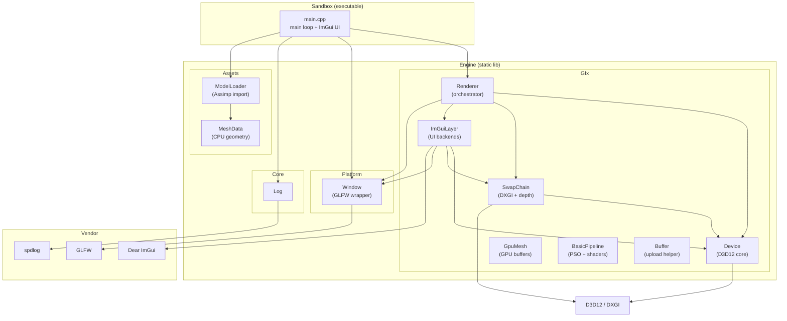
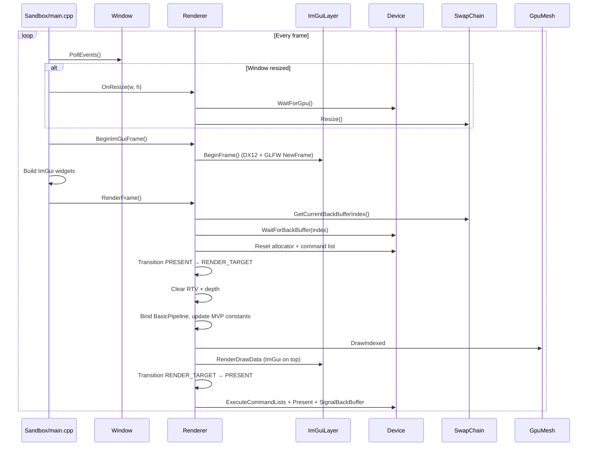
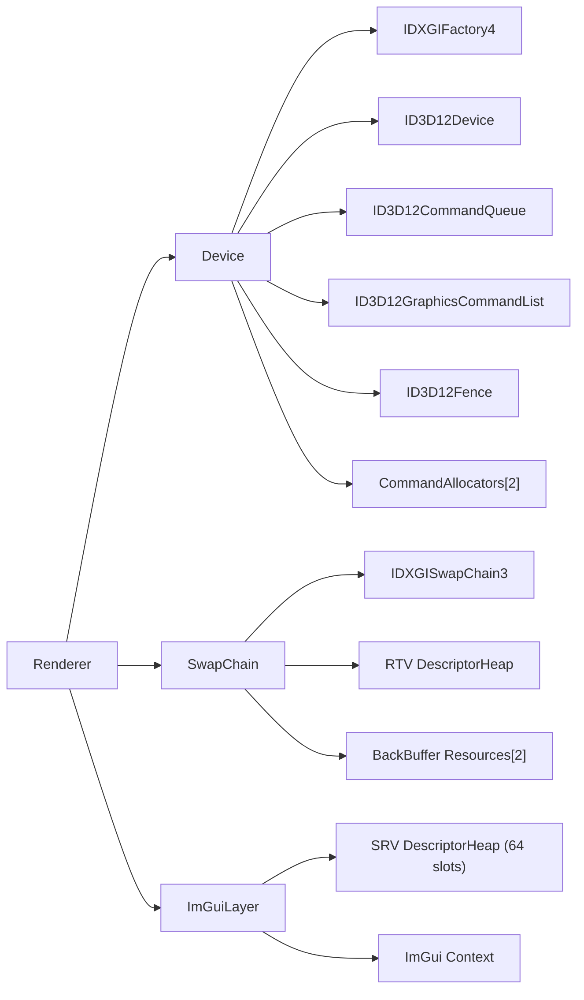
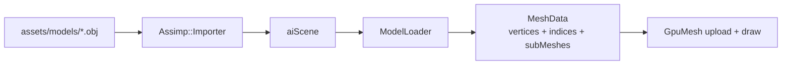

# SummerEngine Architecture

> Sandbox rendering engine for learning and experimenting with D3D12, shaders, and rendering techniques.
> This document reflects the codebase as of **Step 7** (GPU mesh draw).

---

## High-Level Overview

SummerEngine is split into two build targets:

| Target | Type | Role |
|---|---|---|
| **Engine** | Static library | All reusable boilerplate (platform, D3D12, ImGui) |
| **Sandbox** | Console executable | Thin entry point; hosts experiment UI and the main loop |

Third-party code lives in `vendor/` as git submodules. Build is driven by **Premake5** generating a VS 2022 solution.

```
SummerEngine/
├── premake5.lua          # Build configuration
├── docs/                   # Architecture and design notes
├── src/
│   ├── Engine/             # Static lib (summer:: / summer::gfx::)
│   └── Sandbox/            # main.cpp
├── shaders/                # HLSL (empty until mesh rendering step)
├── assets/models/          # Meshes via Assimp (future step)
└── vendor/                 # GLFW, ImGui, spdlog, stb (+ premake binary)
```

---

## Module Diagram



---

## Namespace Layout

| Namespace | Modules | Purpose |
|---|---|---|
| `summer::` | `Log`, `Window` | Platform-agnostic engine utilities |
| `summer::gfx::` | `Device`, `SwapChain`, `Renderer`, `ImGuiLayer` | All D3D12 rendering code |
| `summer::assets::` | `MeshData`, `ModelLoader` | CPU-side geometry imported from files |

Keeping rendering under `gfx::` leaves room for future subsystems (`assets::`, `scene::`, etc.) without polluting the root namespace.

---

## Initialization Order

Startup sequence in `Sandbox/main.cpp`:

```
1. Log::Init()
2. ModelLoader::LoadFromFile()   → CPU MeshData
3. Renderer::SetMesh()           → GPU upload + BasicPipeline init
4. Window creation               → GLFW window + HWND
5. Renderer::Initialize()
   ├── Device::Initialize()     → DXGI factory, D3D12 device, queue, fence
   ├── SwapChain::Initialize()  → DXGI swap chain bound to HWND, RTV heap
   └── ImGuiLayer::Initialize() → ImGui context, GLFW+DX12 backends, SRV heap
```

Shutdown is the reverse, with `Device::WaitForGpu()` first to drain in-flight frames.

---

## Per-Frame Flow

This is the most important loop to understand when adding rendering experiments.



### Where to hook your experiments

| What you want to do | Where to put it |
|---|---|
| UI toggles, debug values | `Sandbox/main.cpp` (between `BeginImGuiFrame` and `RenderFrame`) |
| New render passes / techniques | `Renderer::RenderFrame()` or new methods called from there |
| Shader / PSO experiments | New files under `Gfx/` + `shaders/` (future step) |
| Asset loading / mesh import | `Assets/ModelLoader` — returns `MeshData` |
| Shader / PSO experiments | New files under `Gfx/` + `shaders/` (Step 7) |

---

## D3D12 Object Ownership



### Key constants

- **`FrameCount = 2`** — double-buffered swap chain. Defined in `Device.h`, used by `SwapChain` and `ImGuiLayer`.
- **`SrvHeapCapacity = 64`** — shader-visible descriptor heap shared by ImGui and (eventually) engine textures.

---

## GPU Synchronization Model

D3D12 has no implicit sync. SummerEngine uses a **fence per back buffer**:

1. Before recording into back buffer `N`, check if the GPU finished the previous frame that used `N` (`WaitForBackBuffer`).
2. Record commands, execute, present.
3. Signal the fence with a monotonically increasing value (`SignalBackBuffer`).

Full GPU drain (`WaitForGpu`) is used only at shutdown and resize — expensive, but required before destroying or resizing GPU resources.

```
Back buffer 0: fence value 4  ← GPU still working
Back buffer 1: fence value 3  ← GPU done, safe to record
```

---

## Descriptor Heaps

D3D12 uses descriptor heaps instead of bind slots. SummerEngine currently has two:

| Heap | Type | Owner | Shader-visible? | Purpose |
|---|---|---|---|---|
| RTV heap | `D3D12_DESCRIPTOR_HEAP_TYPE_RTV` | `SwapChain` | No | Back buffer render target views |
| DSV heap | `D3D12_DESCRIPTOR_HEAP_TYPE_DSV` | `SwapChain` | No | Depth-stencil for 3D mesh pass |
| SRV heap | `D3D12_DESCRIPTOR_HEAP_TYPE_CBV_SRV_UAV` | `ImGuiLayer` | **Yes** | ImGui font atlas + future engine textures |

> **Important:** Only one shader-visible heap can be bound per command list (`SetDescriptorHeaps`). When you add engine textures, allocate from the same SRV heap (or redesign heap management).

The SRV heap uses a simple free-list allocator (`ImGuiLayer::DescriptorAllocator`) because ImGui 1.92+ requires the application to provide alloc/free callbacks.

---

## Build System

```
premake5.lua
├── GLFW       (static lib, C)
├── ImGui      (static lib, C++ — core + glfw/dx12 backends)
├── Engine     (static lib, C++ — links GLFW + ImGui + Assimp)
└── Sandbox    (console app, links Engine)
```

**Assimp** is built separately via CMake (vendor-only) because Assimp does not ship a Premake script:

```powershell
.\scripts\build_assimp.ps1
```

This produces static libs in `vendor/assimp/build/lib/{Debug,Release}/`.

Generate and build:

```powershell
.\scripts\compile_shaders.ps1 -Config Debug   # or via Sandbox prebuild
.\vendor\premake\premake5.exe vs2022
msbuild build\SummerEngine.sln /p:Configuration=Debug /p:Platform=x64
.\build\bin\Debug\Sandbox.exe
```

HLSL sources live in `shaders/`. Compiled bytecode goes to `build/shaders/{Debug,Release}/`.

Debug builds define `SUMMER_DEBUG`, which enables the D3D12 debug layer.

---

## Vendor Dependencies

| Library | Submodule path | Used for |
|---|---|---|
| GLFW 3.4 | `vendor/glfw` | Window, input, Win32 HWND |
| Dear ImGui | `vendor/imgui` | Debug UI, experiment controls |
| spdlog | `vendor/spdlog` | Logging (header-only) |
| stb | `vendor/stb` | Image loading (future step) |
| Assimp 6.x | `vendor/assimp` | Mesh import (OBJ, FBX, glTF, …) |

Clone with submodules, then build Assimp:

```powershell
git submodule update --init --recursive
.\scripts\build_assimp.ps1
```

---

## Asset Import Pipeline (Step 6)



`ModelLoader` walks the scene graph, applies node transforms, and merges all meshes into flat CPU arrays. `Renderer::SetMesh()` uploads to GPU via `GpuMesh` and initializes `BasicPipeline` (root signature, PSO, constant buffer).

Shaders (`shaders/BasicVS.hlsl`, `shaders/BasicPS.hlsl`) are yours to experiment with. The C++ side only loads compiled `.cso` bytecode.

---

## Planned Next Steps

| Step | What | New modules / files |
|---|---|---|
| ~~7~~ | ~~GPU mesh + draw call~~ | ~~`Gfx/GpuMesh`, `Gfx/BasicPipeline`, `shaders/`~~ ✓ |
| — | Depth buffer | ✓ (added in Step 7) |
| — | DXC shader build step | ✓ (`scripts/compile_shaders.ps1`) |
| 8+ | Your rendering experiments | PBR, bindless, debug views, etc. |

---

## File Quick Reference

| File | Read this when… |
|---|---|
| `Sandbox/main.cpp` | You want to add UI or change the main loop |
| `Gfx/Renderer.cpp` | You want to add render passes or change frame flow |
| `Gfx/Device.cpp` | You need to understand GPU sync or add D3D12 objects |
| `Gfx/SwapChain.cpp` | You need to change presentation or add depth/stencil |
| `Gfx/ImGuiLayer.cpp` | You need to debug UI rendering or add texture SRVs |
| `Gfx/BasicPipeline.cpp` | You change root signature, PSO, or constant layout |
| `Gfx/GpuMesh.cpp` | You change buffer upload or draw call setup |
| `shaders/BasicVS.hlsl` | Vertex shader experiments |
| `shaders/BasicPS.hlsl` | Pixel shader / lighting experiments |
| `premake5.lua` | You add source files, libs, or shader build steps |
