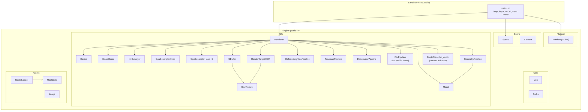
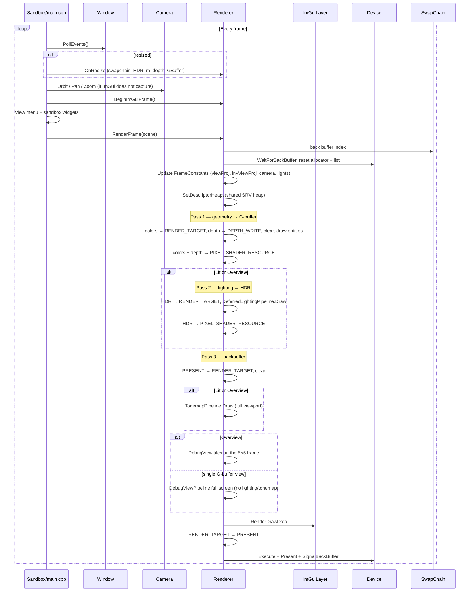
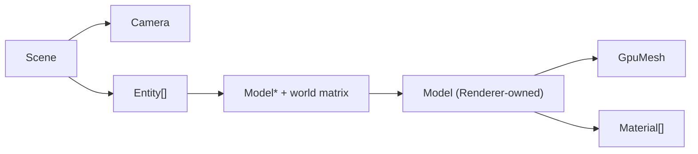
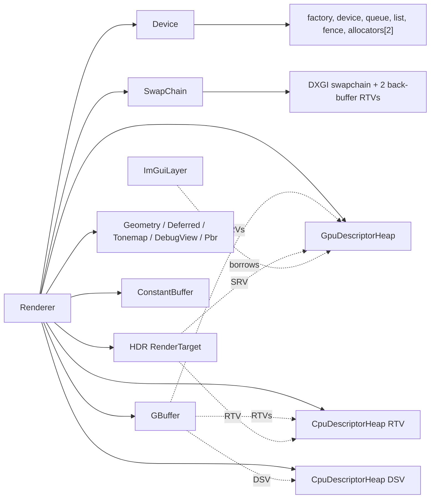
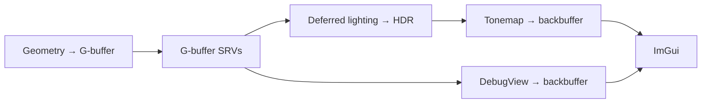
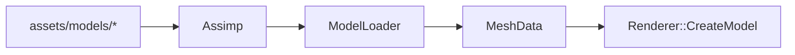

# SummerEngine Architecture

> Sandbox rendering engine for learning and experimenting with D3D12, shaders, and rendering techniques.
>
> **Current frame path (Phase 3):** opaque geometry writes a G-buffer → fullscreen deferred lighting
> writes linear HDR → tonemap to the swapchain. A **View** menu can replace or overlay that resolve
> with G-buffer debug visualization.
>
> The forward `PbrPipeline` is still **created** (HDR + a dedicated depth buffer) but is **not used**
> in `RenderFrame`. It stays for Phase 8 translucency. Do not treat it as the live opaque path.

---

## High-Level Overview

SummerEngine is split into two build targets:

| Target | Type | Role |
|---|---|---|
| **Engine** | Static library | Reusable platform, D3D12, assets, scene, ImGui |
| **Sandbox** | Console executable | Thin entry: scene setup, input, ImGui (including the View menu), main loop |

Third-party code lives in `vendor/` as git submodules. **Premake5** generates a VS 2026 solution (MSVC toolset v145).

```
SummerEngine/
├── premake5.lua            # Build configuration
├── docs/                   # Architecture and design notes
├── scripts/                # Shader compile + asset staging (PowerShell)
├── src/
│   ├── Engine/
│   │   ├── Core/           # Log, Paths
│   │   ├── Platform/       # Window (GLFW)
│   │   ├── Assets/         # MeshData, MaterialData, ModelLoader, Image, Primitives
│   │   ├── Gfx/            # Device, resources, descriptors, pipelines, Renderer
│   │   └── Scene/          # Camera, Scene (entity list)
│   └── Sandbox/            # main.cpp
├── shaders/                # HLSL → DXC → .cso (see shader table at the bottom)
├── assets/models/          # Assimp meshes (cube.obj, FlightHelmet glTF)
└── vendor/                 # GLFW, ImGui, spdlog, stb, Assimp, renderdoc (+ premake)
```

Compiled shaders and assets are **staged next to the executable** (`scripts/stage_assets.ps1`) so
the app runs standalone — required for RenderDoc / PIX, which set their own working directory.

---

## Module Diagram



---

## Namespace Layout

| Namespace | Modules | Purpose |
|---|---|---|
| `summer::` | `Log`, `Paths`, `Window` | Platform utilities |
| `summer::gfx::` | Device, SwapChain, Renderer, ImGuiLayer, descriptor heaps/views, GpuTexture, RenderTarget, DepthStencil, GBuffer, GeometryPipeline, DeferredLightingPipeline, PbrPipeline, TonemapPipeline, DebugViewPipeline, ConstantBuffer, GpuMesh, Buffer, Texture2D, Material, Model, GpuCapture, plus `Lighting.h` and `DebugView.h` | D3D12 rendering |
| `summer::assets::` | MeshData, MaterialData, ModelLoader, Image, Primitives | CPU geometry / images |
| `summer::scene::` | Scene, Entity, Camera | Draw list + orbit camera |

---

## Initialization Order

Startup in `Sandbox/main.cpp`:

```
1. Log::Init()
2. GpuCapture::LoadCaptureTools()     BEFORE the D3D12 device
3. Window creation
4. Renderer::Initialize(window)
   ├── Device
   ├── SwapChain                      back-buffer RTVs only (no depth)
   ├── GpuDescriptorHeap              shader-visible CBV/SRV/UAV
   ├── CpuDescriptorHeap ×2           global RTV + DSV pools
   ├── HDR RenderTarget               R16G16B16A16_FLOAT
   ├── DepthStencil m_depth           D32, not sampled — only to init PbrPipeline
   ├── GBuffer                        3 color RTs + sampleable depth (typeless + DSV + SRV)
   ├── default PBR Texture2Ds
   ├── ConstantBuffer                 FrameConstants × FrameCount
   ├── PbrPipeline                    unused in RenderFrame
   ├── GeometryPipeline               PbrVS + GBufferPS, G-buffer RTV/DSV formats
   ├── DeferredLightingPipeline       FullscreenVS + DeferredLightingPS → HDR
   ├── TonemapPipeline                FullscreenVS + TonemapPS → swapchain
   ├── DebugViewPipeline              FullscreenVS + DebugViewPS → swapchain
   └── ImGuiLayer
5. GpuCapture::SetActiveWindow()
6. CreateTexture / CreateModel / LoadModel
7. Scene + Camera
8. Main loop
```

Shutdown is the reverse. `Device::WaitForGpu()` runs first. Models/textures free SRV slots **before**
the shared heap is destroyed.

---

## Per-Frame Flow

This is the loop to follow when adding rendering work. The live opaque path is **deferred**, not forward PBR.



### Constants: root constants vs per-frame CB

Geometry (and the unused forward PBR PSO) share this layout:

- **Per-object (`b0`):** `model` + `normalMatrix` as **32-bit root constants**. A mapped CB would show
  only the last write of the frame; root constants keep multi-entity draws correct.
- **Per-frame (`b1`):** `FrameConstants` in a mapped `ConstantBuffer` (one 256-byte-aligned slot per
  frame-in-flight). Camera, lights, `viewProj`, and `invViewProj`.
- **Per-material (`b2`):** factors as root constants (base color / emissive / metallic / roughness /
  normal scale / occlusion strength).

`normalMatrix` is uploaded as `inverse(world)`. HLSL reads it column-major, which yields
`transpose(inverse(world))` — the correct normal transform under non-uniform scale.

`invViewProj` is stored the same way as `viewProj` (`XMMatrixTranspose` of the CPU matrix) so
`mul(clip, invViewProj)` in HLSL matches.

### Where to hook experiments

| What you want | Where |
|---|---|
| UI, View menu, scene, camera | `Sandbox/main.cpp` (between `BeginImGuiFrame` and `RenderFrame`) |
| Opaque frame graph | `Renderer::RenderFrame()` |
| G-buffer attachments | `Gfx/GBuffer.*` + `shaders/GBufferPS.hlsl` |
| Lighting / BRDF | `shaders/DeferredLightingPS.hlsl` + `shaders/PbrCommon.hlsli` |
| Debug visualization | `Gfx/DebugView.h`, `DebugViewPipeline`, `shaders/DebugViewPS.hlsl` |
| Forward / translucency later | `Gfx/PbrPipeline` + `shaders/PbrPS.hlsl` |
| Mesh import | `Assets/ModelLoader` |
| Procedural geometry | `Assets/Primitives` |

---

## Scene & Rendering Model



- **`Scene`:** a `Camera` plus `std::vector<Entity>`. No hierarchy or serialization.
- **`Entity`:** borrowed `Model*` + row-major world matrix.
- **`Model`:** one `GpuMesh` (possibly several submeshes), imported textures, one `Material` per
  imported material. Five PBR slots (baseColor / normal / metalRough / occlusion / emissive) plus
  scalar factors. Missing slots use Renderer-owned defaults so bindings are always valid.
  `Model::Draw` takes a `GeometryPipeline&` (the live path).
- **`Camera`:** left-handed orbit camera. LMB orbit, MMB/RMB pan, scroll zoom, WASD/QE.
- **`Renderer`:** owns GPU models/textures and all frame targets/pipelines. `RenderFrame` walks
  entities and records the three passes above.

---

## D3D12 Object Ownership



`RenderTarget` / `DepthStencil` compose a **`GpuTexture`** (resource + tracked state + `Transition`)
and RAII views (`RTVDescriptor` / `SRVDescriptor` / `DSVDescriptor`) that borrow one slot from a
global heap.

**`GBuffer` composes** `std::vector<RenderTarget>` (3 colors) **plus one sampleable `DepthStencil`**.
It does not inherit `RenderTarget`.

**Two depth buffers exist today:**

| Buffer | Sampleable? | Used in `RenderFrame`? | Why it exists |
|---|---|---|---|
| `GBuffer::Depth` | Yes (`R32_TYPELESS` → DSV `D32_FLOAT` + SRV `R32_FLOAT`) | **Yes** — geometry depth test + lighting/debug SRV | Deferred path |
| `Renderer::m_depth` | No | **No** | Still created so `PbrPipeline` can initialize with a DSV format |

Swapchain has **no** depth. Do not add a third.

### Key constants (`Renderer.cpp` / `Device.h`)

- **`FrameCount = 2`**
- **`kSrvHeapCapacity = 1024`** — ImGui, engine textures, HDR SRV, G-buffer SRVs
- **`kRtvHeapCapacity = 64` / `kDsvHeapCapacity = 16`** — HDR + G-buffer colors + both depths

---

## Root Signatures

Root Signature 1.1. Targets that are **rewritten every frame** use
`DATA_STATIC_WHILE_SET_AT_EXECUTE` on their SRV ranges. `DATA_STATIC` would promise the contents never
change and trip the debug layer (`DATA_STATIC_DESCRIPTOR_INVALID_DATA_CHANGE`). Material textures on
the geometry/PBR signatures stay `DATA_STATIC` (they are not render targets).

### GeometryPipeline (live opaque materials) — same layout as PbrPipeline

| Slot | Binding | Purpose |
|---|---|---|
| 0 | 32-bit constants `b0` | model + normalMatrix |
| 1 | CBV `b1` | FrameConstants |
| 2 | 32-bit constants `b2` | material factors |
| 3–7 | SRV tables `t0`–`t4` | baseColor, normal, metalRough, occlusion, emissive |
| static `s0` | anisotropic wrap | |

PSO: 3 G-buffer color RTVs + G-buffer depth. VS = `PbrVS`, PS = `GBufferPS`.

### DeferredLightingPipeline

| Slot | Binding | Purpose |
|---|---|---|
| 0–3 | SRV tables `t0`–`t3` | albedo, normal, material, depth |
| 4 | CBV `b1` | FrameConstants (needs `invViewProj`) |
| static `s0` | point, clamp | |

PSO: HDR RTV, no depth. VS = `FullscreenVS`.

### TonemapPipeline

| Slot | Binding | Purpose |
|---|---|---|
| 0 | SRV `t0` | HDR |
| 1 | 32-bit constants `b0` | exposure + operator |
| static `s0` | linear, clamp | |

### DebugViewPipeline

| Slot | Binding | Purpose |
|---|---|---|
| 0–3 | SRV tables `t0`–`t3` | same G-buffer as lighting |
| 4 | 32-bit constants `b0` | visualization mode |
| static `s0` | point, clamp | |

PSO: swapchain format, no depth.

### PbrPipeline

Same root signature as GeometryPipeline. PSO: HDR RTV + `m_depth` DSV. **Not bound in `RenderFrame`.**

---

## GPU Synchronization

No implicit D3D12 sync. One **fence per back buffer**:

1. `WaitForBackBuffer(N)` before recording into buffer N.
2. Record, execute, present.
3. `SignalBackBuffer(N)`.

`WaitForGpu` (full drain) only at shutdown, resize, and one-shot uploads.

---

## Descriptor Heaps

Global free-list pools. Resources borrow slots via RAII wrappers.

| Heap | Type | Owner | Shader-visible? | Purpose |
|---|---|---|---|---|
| SRV | `GpuDescriptorHeap` | Renderer | **Yes** | ImGui + textures + HDR SRV + G-buffer SRVs |
| RTV pool | `CpuDescriptorHeap` | Renderer | No | HDR + G-buffer colors |
| DSV pool | `CpuDescriptorHeap` | Renderer | No | G-buffer depth + unused `m_depth` |
| Back-buffer RTVs | local RTV heap | SwapChain | No | DXGI back buffers (recreated on resize) |

Only **one** shader-visible CBV/SRV/UAV heap may be bound per command list. Everything that shaders
sample shares `GpuDescriptorHeap`. ImGui 1.92+ alloc/free callbacks go into that heap.

---

## Deferred Pipeline



Lighting and debug both sample the same four SRVs. Lighting is skipped for a single-channel debug view.

### G-buffer layout

| Slot | Format | Contents |
|---|---|---|
| Albedo | `R8G8B8A8_UNORM` | RGB linear albedo, **A occlusion** |
| Normal | `R16G16B16A16_FLOAT` | RGB **world-space** normal (signed, not encoded) |
| Material | `R8G8B8A8_UNORM` | R metallic, G roughness, **B emissive luminance** (not RGB emissive) |
| Depth | DSV `D32_FLOAT` / SRV `R32_FLOAT` | hardware depth; used to rebuild world position |

There is no dedicated world-position RT. `DeferredLightingPS` reconstructs it:

```
clip = (uv.x * 2 - 1, 1 - uv.y * 2, depth, 1)   // Y flip: D3D NDC vs top-left UVs
world = mul(clip, invViewProj).xyz / w
```

Sky / uncleared depth (`depth >= 0.99999`) shades as black.

BRDF lives in `shaders/PbrCommon.hlsli` and is included by both `PbrPS` and `DeferredLightingPS`.
Change the shading model there, not in two pixel shaders.

`FullscreenVS` emits one oversized triangle from `SV_VertexID` (no vertex buffer). Used by lighting,
tonemap, and debug view.

---

## HDR & Tonemap

Deferred lighting (not the forward PBR pass) writes **linear HDR** into `R16G16B16A16_FLOAT`.
`TonemapPS` applies exposure, Reinhard or ACES, then **manual gamma** because the backbuffer is
`_UNORM`, not `_SRGB`. Exposure and operator come from the sandbox UI.

---

## Debug Views

`Renderer::SetDebugView` / `GetDebugView`. The sandbox **View** menu (larger font + padding in
`main.cpp`) drives it.

| Menu | Result |
|---|---|
| **Lit** | Geometry + lighting + tonemap (default) |
| **GBuffer → Overview** | Lit full-screen, then 7 tiles on a 5×5 grid |
| **GBuffer → Albedo, Normal, …** | That channel full-screen; lighting/tonemap skipped |

Overview packing (`FillGBufferOverviewTiles` in `DebugView.h`): first row left-to-right, leftover
tiles on the last row (packed, no holes). If there are ever more tiles than two full rows, extras
take each middle row at column 0 then column max before the last row. Packed channels (occlusion,
metallic, roughness, emissive) are separate menu items even though they share RTs.

Labels are ImGui foreground draw-list stamps, not GPU text.

---

## Asset Import



`ModelLoader` flattens the Assimp graph (transforms on positions **and** normals/tangents), keeps
submeshes + `materialIndex`, runs `aiProcess_CalcTangentSpace`, and stores bitangent handedness in
`tangent.w`. Materials: base color, tangent-space normal, packed metalRough (glTF ORM), occlusion,
emissive, plus factors. Paths are relative to the model file.

`CreateModel` uploads `GpuMesh` and textures (deduped by path + colorspace): **sRGB** for base color
and emissive, **linear** for normal / metalRough / occlusion.

**FlightHelmet** (`assets/models/FlightHelmet/glTF/`) is the multi-material PBR sample.

---

## GPU Capture

`Gfx/GpuCapture`:

- **PIX** — load `WinPixGpuCapturer.dll` before device creation so a standalone launch can attach.
- **RenderDoc** — in-app API when launched from RenderDoc; F11 / UI button captures the next frame.

No-ops if the tool is missing. `Paths` is exe-relative so captures still find shaders/assets.

---

## Build System

```
premake5.lua → GLFW, ImGui, Engine, Sandbox
Assimp      → scripts/build_assimp.ps1 (CMake, not Premake)
```

```powershell
.\vendor\premake\premake5.exe vs2026
msbuild build\SummerEngine.slnx /p:Configuration=Debug /p:Platform=x64
.\build\bin\Debug\Sandbox.exe
```

- VS **2026** / toolset **v145** / Windows SDK `latest`. Assimp CMake generator `Visual Studio 18 2026`
  → `assimp-vc145-*`.
- Prebuild: `scripts/compile_shaders.ps1` (DXC → `build/shaders/`, PDBs embedded for PIX/RenderDoc).
- Postbuild: `scripts/stage_assets.ps1` copies `.cso`/`.pdb` + `assets/` next to the exe.
- `SUMMER_DEBUG` enables the D3D12 debug layer.

---

## Vendor Dependencies

| Library | Path | Used for |
|---|---|---|
| GLFW 3.4 | `vendor/glfw` | Window, input, HWND |
| Dear ImGui | `vendor/imgui` | Debug UI + View menu |
| spdlog | `vendor/spdlog` | Logging |
| stb | `vendor/stb` | `stb_image` |
| Assimp 6.x | `vendor/assimp` | Mesh/material import |
| FlightHelmet | `assets/models/FlightHelmet/` (CC0) | glTF PBR sample |
| RenderDoc API | `vendor/renderdoc` | In-app capture header |

---

## Roadmap

Phases stack; later work should not rewrite the deferred frame graph unless the phase says so.

### Done

- **Phase 0** — logging, `Image`/`Texture2D`, shared SRV heap, PIX/RenderDoc, `Paths`
- **Phase 1** — submeshes, `Model`, Assimp materials, `Scene` + orbit camera
- **Phase 2** — forward Cook–Torrance PBR, lights, HDR + tonemap, FlightHelmet.
  *Optional leftover: IBL.* The **PSO** remains; the **frame** moved to deferred.
- **Phase 3** — G-buffer + deferred lighting (`PbrCommon.hlsli`) + debug View menu.
  Emissive is luminance in material.b.

### Next

- **Phase 4 — Shadows** — directional depth map + PCF in the **deferred lighting** pass, then CSMs.
- **Phase 5 — Many lights** — CPU tile lists, then compute tiled/clustered cull, then bindless
  (SM6.6). First compute/UAV work; lighting shader consumes the lists.
- **Phase 6 — Instancing** — depends only on Phase 1; useful before foliage.
- **Phase 7 — Foliage** — alpha test in the **G-buffer** pass (not blending).
- **Phase 8 — Translucency** — forward pass **after** deferred+tonemap, using `PbrPipeline`.
- **Phase 9 — Volumetric fog** — after shadows; reuses Phase 5 compute.
- **Phase 10 — GPU particles** — compute sim + transparent pass.

```
Phase 0–1 ─→ Phase 2 PBR(fwd) ─→ Phase 3 Deferred ─→ Phase 4 Shadows ─┬─→ Phase 5 culling/bindless
                                                                     └─→ Phase 9 volumetrics
           ─→ Phase 6 instancing ─┬─→ Phase 7 foliage
                                  └─→ Phase 8 translucency ─→ Phase 10 particles
```

Keep the forward PSO for translucency. Do not put blending into the G-buffer.

---

## File Quick Reference

| File | Read this when… |
|---|---|
| `Sandbox/main.cpp` | UI, View menu, scene, camera |
| `Gfx/Renderer.cpp` | Frame graph, resource init |
| `Gfx/Device.cpp` | Sync, D3D12 device/queue |
| `Gfx/SwapChain.cpp` | Presentation, back-buffer RTVs |
| `Gfx/GpuDescriptorHeap.cpp` | Shared shader-visible heap |
| `Gfx/CpuDescriptorHeap.cpp` | RTV/DSV pools |
| `Gfx/Descriptors.cpp` | SRV/RTV/DSV wrappers |
| `Gfx/GpuTexture.cpp` | Texture resources + barriers |
| `Gfx/RenderTarget.cpp` | Offscreen color (HDR, G-buffer colors) |
| `Gfx/DepthStencil.cpp` | Depth (± sampleable SRV) |
| `Gfx/GBuffer.cpp` | G-buffer attachments |
| `Gfx/GeometryPipeline.cpp` | G-buffer write PSO |
| `Gfx/DeferredLightingPipeline.cpp` | Fullscreen lighting PSO |
| `Gfx/DebugView.h` | `DebugView` enum + overview tile layout |
| `Gfx/DebugViewPipeline.cpp` | G-buffer visualization PSO |
| `Gfx/PbrPipeline.cpp` | Forward PBR PSO (unused in the frame) |
| `Gfx/TonemapPipeline.cpp` | HDR → backbuffer |
| `Gfx/Lighting.h` | `FrameConstants` / lights (keep in sync with HLSL) |
| `Gfx/Model.cpp` | Materials + `Draw(GeometryPipeline&)` |
| `Gfx/ImGuiLayer.cpp` | ImGui backends + shared-heap callbacks |
| `Assets/ModelLoader.cpp` | Import |
| `shaders/PbrVS.hlsl` | Vertex shader (geometry + unused forward) |
| `shaders/GBufferPS.hlsl` | Pack G-buffer |
| `shaders/PbrCommon.hlsli` | Shared BRDF |
| `shaders/DeferredLightingPS.hlsl` | Lighting + world-from-depth |
| `shaders/PbrPS.hlsl` | Forward PBR (future translucency) |
| `shaders/FullscreenVS.hlsl` | Fullscreen triangle |
| `shaders/TonemapPS.hlsl` | Tonemap / gamma |
| `shaders/DebugViewPS.hlsl` | G-buffer debug modes |
| `premake5.lua` | Sources, libs, pre/post build |
